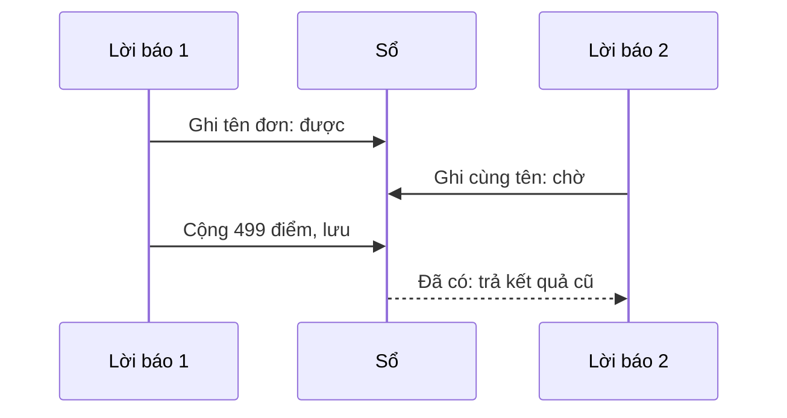

# Example: one finished opener question (owner-approved 2026-11-23)

Outbox & Idempotency, question 4. Use it for voice and length; the numbers here (499.000đ, 499 điểm, 12 lời báo) come from that lesson.

**23:15 · Câu 4 / 5 · Mây Coffee, đêm Black Friday**

## Bối cảnh

Khách trả 499.000đ cho một đơn. Hệ thống báo sang dịch vụ tích điểm "đơn này đã trả tiền". Vì có lúc không nhận được xác nhận, hệ
thống gửi lại lời báo, và lần này 12 lời báo của cùng một đơn tới gần như cùng lúc.

Mỗi lần nhận, dịch vụ tích điểm làm 3 bước:
1. Tra sổ: đơn này đã cộng điểm chưa?
2. Chưa thì cộng 499 điểm.
3. Ghi vào sổ: đơn này đã cộng.

**Kết quả:** khách được cộng 499 điểm 12 lần.

> Chi tiết kỹ thuật: dịch vụ tích điểm = Loyalty · sổ = bảng `processed_events` · bước 1 = `SELECT` · bước 3 = `INSERT` khóa
> idempotency.

## Câu hỏi

Sửa sao cho dù bao nhiêu lời báo tới cùng lúc, điểm chỉ được cộng một lần?

| | Đáp án | Lý do |
| --- | --- | --- |
| A | Gói 3 bước vào một transaction | Không ngăn 12 lời báo cùng tra sổ ở bước 1: lúc đó sổ chưa có dòng nào để khóa. |
| **B** | **Ghi sổ trước, sổ không cho ghi trùng** | **Chỉ một lời báo ghi được; những lời báo sau thấy "đã có".** |
| C | Khóa trong code quanh handler | Chỉ chặn được trong một máy; dịch vụ chạy nhiều máy. |
| D | Chuyển sổ sang Redis, tra trước khi cộng | Vẫn là tra rồi mới làm; sổ và điểm lại không ghi cùng nhau. |

## Vì sao

**Chuyện gì đã xảy ra**

| | Lời báo 1 | Lời báo 2 |
| --- | --- | --- |
| 1 | Tra sổ: chưa cộng | Tra sổ: chưa cộng |
| 2 | Cộng 499 điểm | Cộng 499 điểm (lần hai) |
| 3 | Ghi sổ: đã cộng | Ghi sổ: đã cộng |

**Gốc rễ: tra sổ và ghi sổ là hai bước tách rời, nên ở giữa có một khe.**

**Cách sửa bằng lời thường.** Đảo thứ tự: ghi tên đơn vào sổ trước, và sổ không cho ghi trùng một tên. Giống bốc số thứ tự: chỉ một
người cầm được số đó. Ai ghi được thì cộng điểm. Người đến sau thấy "đã có", nên trả lại đúng kết quả lần đầu mà không cộng nữa. Ghi
sổ và cộng điểm nằm chung một lần lưu, nên máy chết giữa chừng thì cả hai cùng hủy.

*Nhìn bước 2: lời báo 2 phải chờ, không tự tra sổ được nữa.*

**Cái giá.** Lời báo trùng xếp hàng chờ lời báo đầu lưu xong. Sổ lớn dần, phải dọn những tên cũ quá thời gian hệ thống còn có thể gửi lại.

**Code** (thu gọn): the real lines from the lesson's `solution/`, path and range, highlighted lines.

**Người phỏng vấn muốn biết.** Bạn có nhận ra kiểu lỗi "tra rồi mới làm" ở bất cứ đâu (tồn kho, tên đăng ký, chống trùng), và biết để
database phân xử thay vì code.

**Trả lời phỏng vấn**
- Triệu chứng: một đơn được cộng điểm 12 lần.
- Nguyên nhân: check-then-act, 12 lời báo cùng tra sổ thấy chưa có.
- Cách sửa: `INSERT` khóa trước dưới unique constraint, cùng transaction với việc cộng điểm; bản trùng nhận kết quả đã lưu.
- Cái giá: bản trùng xếp hàng sau một dòng khóa; phải dọn khóa cũ.
