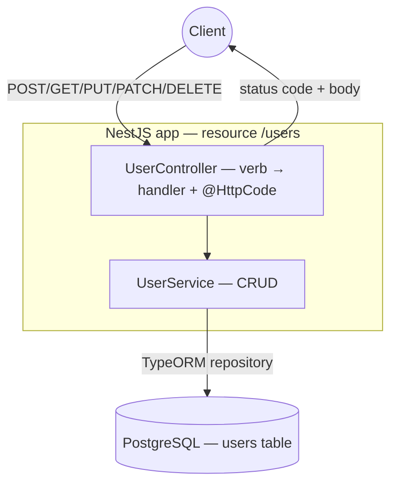

# sortIndex
<!-- @starci/seperator -->
1
<!-- @starci/seperator -->
# lang
<!-- @starci/seperator -->
typescript
<!-- @starci/seperator -->
# body
<!-- @starci/seperator -->
## 1. Opening

*"Since it's all `users`, why can't I just do `POST /createUser`, `POST /updateUser`, `POST /deleteUser` for simplicity?"* — a **Senior Engineer** asks. A **Mid-level Developer** replies: *"As long as the server understands it, using `POST` for everything works fine."* The answer lacks depth: collapsing everything into `POST` throws away the contract that clients and proxies rely on — you can no longer tell reads from writes to cache, you don't know which operation is *idempotent* so it can be safely retried, and the returned status code says nothing about the outcome (created vs not-found both return `200`).

REST is not an arbitrary convention: each **HTTP verb** maps to an *operation* on a resource, and each **status code** is a standard answer to the client. This lesson builds a `users` backend with **NestJS + TypeORM** on **PostgreSQL**, then calls each verb to **observe** exactly this contract — status code and body:

- **Part 2.1**: **hands-on** runs the demo and verifies 4 flows (create, read/404, `PUT` full-replace vs `PATCH` partial, delete 204).
- **Part 2.2**: **theory** consolidates the essence *verb → operation → status code → idempotency*, plus typical **edge cases**.

## 2. Core concepts

This lesson follows **practice-led theory**. Students clone the source, spin up PostgreSQL with Docker, run **NestJS** via `nest start --watch`, then call the API to **observe** each HTTP verb map to a distinct operation and status code. The theory part then consolidates REST semantics (verbs, status codes, idempotency) and analyzes deep edge cases.

### 2.1. Hands-on

#### 2.1.1. Prepare source code and environment

Purpose: run the `users` demo to see each verb (`POST`/`GET`/`PUT`/`PATCH`/`DELETE`) return the correct status code and body per the REST contract.

Source: [StarCi-Academy/fs-3-rest-api-design-and-documentation-0-restful-api-crud-best-practices](https://github.com/StarCi-Academy/fs-3-rest-api-design-and-documentation-0-restful-api-crud-best-practices) on GitHub.

```bash
# Step 1: Clone the repository locally
git clone https://github.com/StarCi-Academy/fs-3-rest-api-design-and-documentation-0-restful-api-crud-best-practices.git

# Step 2: Navigate to the lesson directory
cd fs-3-rest-api-design-and-documentation-0-restful-api-crud-best-practices
```

#### 2.1.2. Architecture / components

The demo fits into a single `users` resource backed by one PostgreSQL table — enough for every verb to act on the same observable state:

- `UserController`: the HTTP adapter that maps each verb (`@Post`/`@Get`/`@Put`/`@Patch`/`@Delete`) to a handler; attaches status codes via `@HttpCode`. No business logic.
- `UserService`: holds the CRUD business logic — `create`/`findAll`/`findOne`/`update` (full replace)/`patch` (partial)/`remove`; throws `NotFoundException` (→ 404) when an id is missing.
- `UserEntity`: maps the `users` table (`id`/`name`/`email`) for TypeORM.
- **PostgreSQL:** the persistence layer — durable state across requests so each verb's side effect is observable.

| Component | File | Role |
| --- | --- | --- |
| `UserController` | `src/modules/user/user.controller.ts` | Map verb → handler + status code (`@HttpCode`) |
| `UserService` | `src/modules/user/user.service.ts` | CRUD logic; throws `NotFoundException` → 404 |
| `UserEntity` | `src/entities/postgresql/main/user.entity.ts` | Maps the `users` table (id/name/email) |
| `AppModule` | `src/app.module.ts` | Wires `ConfigModule` + TypeORM (PostgreSQL) + `UserModule` |



Figure 1: Each HTTP verb enters its own handler, acts on the same `users` table, and returns a different status code.

#### 2.1.3. Code walkthrough and essence

Focus: *why each verb needs its own handler with its own status code — and why `PUT` differs from `PATCH`, why an idempotent delete returns 204*.

##### 2.1.3.1. Verb maps to operation — and `@HttpCode` picks the status code

```typescript
@Post()
@HttpCode(HttpStatus.CREATED)
async create(@Body() payload: Partial<User>): Promise<User> {
    return this.usersService.create(payload)
}

@Delete(":id")
@HttpCode(HttpStatus.NO_CONTENT)
async remove(@Param("id") id: string): Promise<void> {
    await this.usersService.remove(id)
}
```

`@Post()` registers a handler for the resource-creation verb and `@HttpCode(201)` forces a `201 Created` instead of NestJS's default `200` — clearly saying "a new resource was created". `@Delete(":id")` + `@HttpCode(204)` returns `204 No Content`: the delete succeeded but there is no body to return. The essence: the status code is a *contract* — clients read the number to learn the outcome without parsing the body.

##### 2.1.3.2. `PUT` full replace vs `PATCH` partial update

```typescript
// PUT — full replace: client sends the whole representation, assign every field DIRECTLY (NO `??` fallback).
async update(id: string, payload: User): Promise<User> {
    const row = await this.usersRepo.findOne({ where: { id } })
    if (!row) throw new NotFoundException(`User with ID ${id} not found`)
    row.name = payload.name
    row.email = payload.email
    return this.toUser(await this.usersRepo.save(row))
}

// PATCH — partial update: ONLY provided fields change (use `Partial` + `??`/`!== undefined`).
async patch(id: string, payload: Partial<User>): Promise<User> {
    const row = await this.usersRepo.findOne({ where: { id } })
    if (!row) throw new NotFoundException(`User with ID ${id} not found`)
    if (payload.name !== undefined) row.name = payload.name
    if (payload.email !== undefined) row.email = payload.email
    return this.toUser(await this.usersRepo.save(row))
}
```

`PUT` carries *replace-the-whole-representation* semantics: the client sends every field and the server assigns `payload.name`/`payload.email` directly onto the row — it does not use `??` to keep old values, because that would let an absent field survive, which is exactly `PATCH` behavior and contradicts "overwrite the whole state". Sending the same `PUT` body again always yields the same state — that is **idempotency**. `PATCH`, by contrast, takes a `Partial<User>` and only touches fields present in the payload (distinguished via `!== undefined`), so sending `{ "name": "X" }` leaves `email` untouched. The essence: the two verbs differ because their *write scope* differs, not as a matter of convenience.

##### 2.1.3.3. Not found → `NotFoundException` becomes `404`

```typescript
async findOne(id: string): Promise<User> {
    const row = await this.usersRepo.findOne({ where: { id } })
    if (!row) {
        throw new NotFoundException(`User with ID ${id} not found`)
    }
    return this.toUser(row)
}
```

When the resource does not exist, the service throws `NotFoundException`; NestJS turns it into a `404 Not Found` response. The essence: a domain error (resource absent) is translated to a standard status code — the client distinguishes "missing" from "present but empty" (`200` + `[]`) purely by the number.

> This concept is portable: REST verbs/status codes/idempotency are universal HTTP contracts, not framework-specific. Brief mapping — Spring (`@PostMapping` + `ResponseEntity.status(201)` / `@ResponseStatus`), ASP.NET Core (`[HttpPost]` + `CreatedAtAction`/`NoContent()`/`NotFound()`), Go (`net/http` `mux.HandleFunc` + `w.WriteHeader(http.StatusCreated)`). All share the idea: the verb picks the operation, the status code is the standard answer to the client.

#### 2.1.4. Prepare and launch

##### 2.1.4.1. Prerequisites

- **Node.js** LTS (≥ 18), **npm**, **NestJS CLI** (`npm i -g @nestjs/cli`).
- **Docker** + **Docker Compose** (to run PostgreSQL infra).
- Port **3000** available on the host (NestJS backend); port **5432** available (PostgreSQL).
- **Windows:** use `Invoke-RestMethod` instead of `curl`.

##### 2.1.4.2. Launch

```bash
# Step 1: Spin up PostgreSQL with Docker (infra — run from lesson root)
docker compose -f .docker/compose.yaml up -d

# Step 2: Install dependencies
cd backend/0-typescript
npm install

# Step 3: Run the backend in watch mode
nest start --watch
```

The app listens on `http://localhost:3000`. Before running the test flows, call `POST /users/demo/seed-one` to have a sample record ready (fixed faker seed).

#### 2.1.5. Testing

The **4 flows** below verify 4 facets of the REST contract:

- **Flow 1 — `POST /users`:** create a user.
- **Flow 2 — `GET /users/:id`:** read one user / a missing id.
- **Flow 3 — `PUT /users/:id` then `PATCH /users/:id`:** `PUT` (full replace) vs `PATCH` (partial).
- **Flow 4 — `DELETE /users/:id`:** delete a user.

::::accordion
:::panel{title="Flow 1 — `POST` creates a resource → 201"}

- Step 1: call `POST /users` with body `{ name, email }`.

  ```bash
  # Windows (PowerShell)
  Invoke-RestMethod -Method Post -Uri "http://localhost:3000/users" -ContentType "application/json" -Body '{"name":"Ada Lovelace","email":"ada@example.com"}'

  # macOS / Linux
  # → Paste cURL into Postman: Import → Raw text
  curl -s -X POST http://localhost:3000/users -H "Content-Type: application/json" -d '{"name":"Ada Lovelace","email":"ada@example.com"}'
  ```

  The response must be (HTTP 201):

  ```json
  { "id": "a1b2c3", "name": "Ada Lovelace", "email": "ada@example.com" }
  ```

*Conclusion: If the response matches the JSON above, the system confirms:*

- *`POST` creates a new resource and returns `201 Created` with the just-created representation (including the server-assigned `id`).*

:::
:::panel{title="Flow 2 — `GET` reads → 200 / missing → 404"}

- Step 1: read the just-created user by the `id` from Flow 1 — `GET /users/a1b2c3`.

  ```bash
  # Windows (PowerShell)
  Invoke-RestMethod -Uri "http://localhost:3000/users/a1b2c3"

  # macOS / Linux
  # → Paste cURL into Postman: Import → Raw text
  curl -s http://localhost:3000/users/a1b2c3
  ```

  The response must be (HTTP 200):

  ```json
  { "id": "a1b2c3", "name": "Ada Lovelace", "email": "ada@example.com" }
  ```

- Step 2: read a missing id — `GET /users/does-not-exist`.

  ```bash
  # Windows (PowerShell)
  Invoke-RestMethod -Uri "http://localhost:3000/users/does-not-exist"

  # macOS / Linux
  # → Paste cURL into Postman: Import → Raw text
  curl -s -i http://localhost:3000/users/does-not-exist
  ```

  The response must be (HTTP 404):

  ```json
  { "statusCode": 404, "message": "User with ID does-not-exist not found", "error": "Not Found" }
  ```

*Conclusion: If the response matches the JSON above, the system confirms:*

- *`GET` reading a resource returns `200` + body; an absent resource returns `404` — the client distinguishes "missing" from "present but empty" by status code.*

:::
:::panel{title="Flow 3 — `PUT` (full replace) vs `PATCH` (partial)"}

- Step 1: `PUT /users/a1b2c3` sending the full representation (`name` + `email`) → overwrites the whole resource.

  ```bash
  # Windows (PowerShell)
  Invoke-RestMethod -Method Put -Uri "http://localhost:3000/users/a1b2c3" -ContentType "application/json" -Body '{"name":"Ada L.","email":"ada@example.com"}'

  # macOS / Linux
  # → Paste cURL into Postman: Import → Raw text
  curl -s -X PUT http://localhost:3000/users/a1b2c3 -H "Content-Type: application/json" -d '{"name":"Ada L.","email":"ada@example.com"}'
  ```

  The response must be (HTTP 200):

  ```json
  { "id": "a1b2c3", "name": "Ada L.", "email": "ada@example.com" }
  ```

- Step 2: `PATCH /users/a1b2c3` sending only `email` → only that field changes, `name` stays.

  ```bash
  # Windows (PowerShell)
  Invoke-RestMethod -Method Patch -Uri "http://localhost:3000/users/a1b2c3" -ContentType "application/json" -Body '{"email":"ada.l@example.com"}'

  # macOS / Linux
  # → Paste cURL into Postman: Import → Raw text
  curl -s -X PATCH http://localhost:3000/users/a1b2c3 -H "Content-Type: application/json" -d '{"email":"ada.l@example.com"}'
  ```

  The response must be (HTTP 200):

  ```json
  { "id": "a1b2c3", "name": "Ada L.", "email": "ada.l@example.com" }
  ```

*Conclusion: If the response matches the JSON above, the system confirms:*

- *`PUT` carries full-replace semantics (idempotent), `PATCH` only touches the fields sent — the two verbs have different write scopes, clearly observable by which field changed.*

:::
:::panel{title="Flow 4 — `DELETE` → 204 no body"}

- Step 1: delete the user — `DELETE /users/a1b2c3`.

  ```bash
  # Windows (PowerShell)
  Invoke-RestMethod -Method Delete -Uri "http://localhost:3000/users/a1b2c3" -StatusCodeVariable code; $code

  # macOS / Linux
  # → Paste cURL into Postman: Import → Raw text
  curl -s -o /dev/null -w "%{http_code}\n" -X DELETE http://localhost:3000/users/a1b2c3
  ```

  The response must be HTTP 204 with an empty body:

  ```json
  204
  ```

*Conclusion: If the status code is 204 and the body is empty, the system confirms:*

- *`DELETE` removes the resource and returns `204 No Content` — the operation succeeded but there is nothing to return in the body.*

:::
::::

#### 2.1.6. Clean up resources

```bash
# Stop and remove the PostgreSQL container + volume
docker compose -f .docker/compose.yaml down -v
```

Press `Ctrl+C` in the terminal to stop NestJS.

#### 2.1.7. Further reading

- **Controllers & routing:** how NestJS maps verbs (`@Get`/`@Post`/`@Put`/`@Patch`/`@Delete`) to handlers. ([NestJS Controllers](https://docs.nestjs.com/controllers))
- **Status code (`@HttpCode`):** setting a handler's default status code. ([NestJS Controllers — Status code](https://docs.nestjs.com/controllers#status-code))
- **Exception filters:** how `NotFoundException` is translated to `404`. ([NestJS Exception filters](https://docs.nestjs.com/exception-filters))

### 2.2. Theory

#### 2.2.1. Essence

The essence of REST over HTTP boils down to one thing: **a resource (`users`) is operated on through a standard set of verbs, and each outcome is encoded by a standard status code — the client understands the contract without knowing the server's implementation details**. The facets below are not disjoint conventions but views of that same contract.

- **Verb → operation (uniform interface).** Instead of naming the action in the URL (`/createUser`, `/deleteUser`), REST fixes the *verb* in the HTTP method and the *noun* in the URL: `POST /users` (create), `GET /users/:id` (read), `PUT` (full replace), `PATCH` (partial update), `DELETE` (remove). Why this is core: a uniform surface lets generic tooling (cache proxies, API gateways, client generators) understand the API without bespoke documentation. Verified in Flows 1 and 4: same URL `/users/:id`, change the verb and the operation changes.
- **Status code is the standard answer.** `201` (created), `200` (OK + body), `204` (OK, no body), `404` (not found) — the client reads the *number* to branch its logic, not by parsing a message string. The essence: the status code separates *outcome* from *data*; a `GET` returning `200 []` (resource present but empty) differs entirely from `404` (resource absent) even when the bodies look similar. Verified in Flow 2.
- **Idempotency and safe retries.** `GET`/`PUT`/`DELETE` are **idempotent** — calling them repeatedly converges to the same final state, so clients/proxies can safely retry on flaky networks; `POST` is not idempotent (calling it twice creates two resources). Why it matters: in distributed systems, knowing which verb is safe to retry decides your mechanism against lost/duplicated requests. Comparing `PUT` (full replace) and `PATCH` (partial) in Flow 3 shows that the same `PUT` body always returns to the same state.

Putting it together: REST turns a resource into a contract of *verb + URL + status code + idempotency property*. Understanding a new REST API is exactly reading what each verb does on the resource and what each status code tells you.

#### 2.2.2. Edge cases to watch

- **Using `200` for everything (even create/delete):** the client loses the signal to distinguish outcomes. **Solution:** use `@HttpCode` to set `201`/`204` per the verb's semantics.
- **Confusing `PUT` with `PATCH`:** sending a `PUT` with missing fields and assuming the others are preserved → in fact `PUT` carries full-replace semantics. **Solution:** use `PATCH` when you only want a partial update; always send the full representation with `PUT`.
- `DELETE` on an already-deleted resource: the second delete returns `404` whereas `DELETE` is meant to be idempotent. **Solution:** accept that a later `404` is valid (the final "does not exist" state is unchanged), or return `204` for repeats depending on your API policy.
- **Wrapping a domain error as `500`:** throwing a plain `Error` instead of `NotFoundException` turns an absent resource into a server error. **Solution:** use the framework's proper domain exception (`NotFoundException` → `404`).

## 3. Summary

### 3.1. Common interview questions

- **Question 1: What is the difference between `PUT` and `PATCH`, and when do you use each?**
  - What the interviewer wants to hear: `PUT` replaces the whole representation (idempotent), `PATCH` updates a part.
  - Sample answer (short): `PUT` carries overwrite-the-whole-resource semantics, so resending the same body always yields the same state — idempotent. `PATCH` only touches the fields present in the payload. Use `PUT` when the client holds and sends the full representation; use `PATCH` when you only want to change a few fields without touching the rest.
- **Question 2: Why not collapse everything into `POST` with URLs like `/createUser`, `/updateUser`?**
  - What the interviewer wants to hear: uniform interface — the verb fixes the operation, the noun is the URL, so generic tooling understands it.
  - Sample answer (short): REST puts the verb in the HTTP method and the noun in the URL, so cache proxies, gateways, and client generators understand the API without bespoke conventions. Collapsing to `POST` loses the ability to distinguish reads/writes for caching, loses the idempotency signal for safe retries, and the status code no longer reflects the outcome.
- **Question 3: What is idempotency and why does it matter for retries?**
  - What the interviewer wants to hear: repeated calls converge to the same final state; `GET`/`PUT`/`DELETE` are idempotent, `POST` is not.
  - Sample answer (short): Idempotent means calling once or many times leads to the same final state. `GET`/`PUT`/`DELETE` are idempotent, so on a flaky network clients/proxies can retry safely. `POST` is not idempotent — a retry can create a duplicate resource — so it needs an idempotency key or a separate de-duplication mechanism.
<!-- @starci/seperator -->
