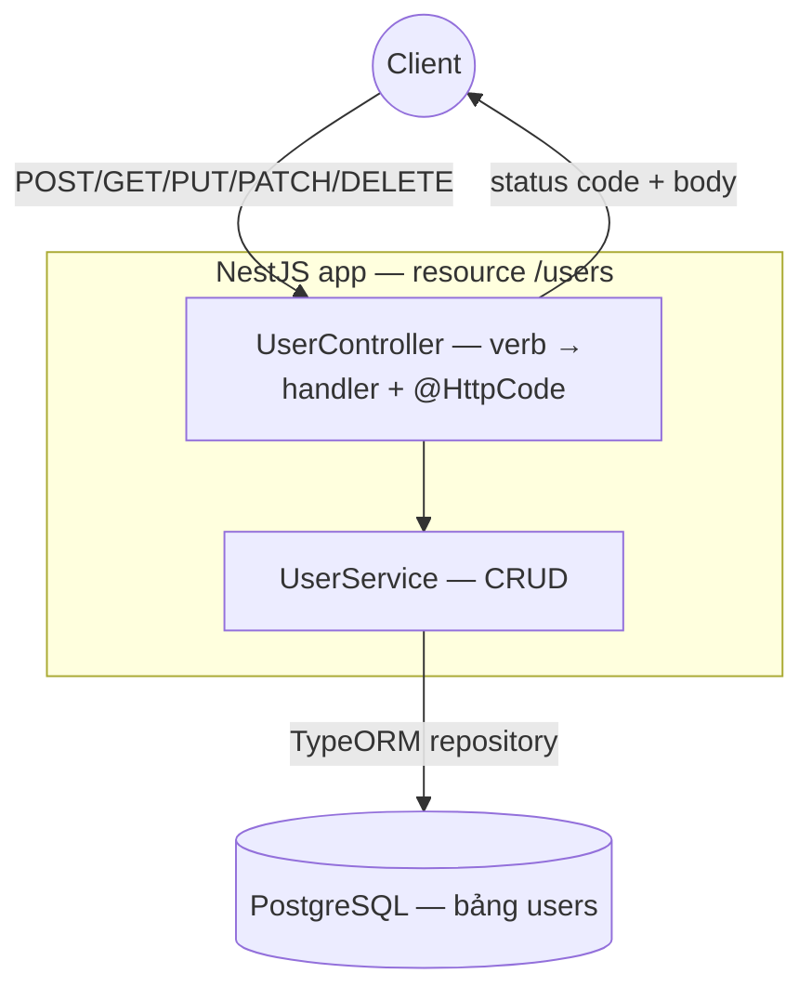

# sortIndex
<!-- @starci/seperator -->
1
<!-- @starci/seperator -->
# lang
<!-- @starci/seperator -->
typescript
<!-- @starci/seperator -->
# body
<!-- @starci/seperator -->
## 1. Lời mở đầu

*"Cùng là `users`, vì sao tôi không thể chỉ làm `POST /createUser`, `POST /updateUser`, `POST /deleteUser` cho gọn?"* — một **Senior Engineer** hỏi. **Mid-level Developer** đáp: *"Miễn server hiểu là được, dùng `POST` hết cũng chạy mà."* Câu trả lời thiếu chiều sâu: dồn mọi thứ vào `POST` làm mất hợp đồng (contract) mà client và proxy dựa vào — không phân biệt được đọc với ghi để cache, không biết thao tác nào **idempotent** để retry an toàn, và status code trả về không nói lên kết quả (tạo mới hay không tìm thấy đều `200`).

REST không phải quy ước tuỳ hứng: mỗi **HTTP verb** ánh xạ tới một *thao tác* trên resource, mỗi **status code** là một câu trả lời chuẩn cho client. Bài học triển khai một backend `users` bằng **NestJS + TypeORM** trên **PostgreSQL**, rồi gọi từng verb để **quan sát** đúng thứ contract này — status code và body:

- **Phần 2.1**: **thực hành** chạy demo và kiểm chứng 4 luồng (tạo, đọc/404, `PUT` thay-toàn-bộ vs `PATCH` sửa-một-phần, xoá 204).
- **Phần 2.2**: **lý thuyết** hệ thống hoá bản chất *verb → thao tác → status code → idempotency*, kèm các **edge case** điển hình.

## 2. Các khái niệm cốt lõi

Bài tuân theo **Thực hành dẫn dắt Lý thuyết**. Học viên clone source, dựng PostgreSQL bằng Docker, chạy **NestJS** với `nest start --watch` rồi gọi API để **quan sát** từng HTTP verb ánh xạ ra một thao tác và status code khác nhau. Sau đó phần lý thuyết hệ thống hoá ngữ nghĩa REST (verb, status code, idempotency) và phân tích các edge case chuyên sâu.

### 2.1. Thực hành

#### 2.1.1. Chuẩn bị source code và môi trường

Mục đích: chạy demo `users` để thấy mỗi verb (`POST`/`GET`/`PUT`/`PATCH`/`DELETE`) trả về đúng status code và body theo contract REST.

Source: [StarCi-Academy/fs-3-rest-api-design-and-documentation-0-restful-api-crud-best-practices](https://github.com/StarCi-Academy/fs-3-rest-api-design-and-documentation-0-restful-api-crud-best-practices) trên GitHub.

```bash
# Step 1: Clone the repository locally
git clone https://github.com/StarCi-Academy/fs-3-rest-api-design-and-documentation-0-restful-api-crud-best-practices.git

# Step 2: Navigate to the lesson directory
cd fs-3-rest-api-design-and-documentation-0-restful-api-crud-best-practices
```

#### 2.1.2. Kiến trúc / thành phần

Demo gói gọn trong một resource `users` với một bảng PostgreSQL — đủ để mỗi verb tác động lên cùng một tập state quan sát được:

- `UserController`: HTTP adapter map mỗi verb (`@Post`/`@Get`/`@Put`/`@Patch`/`@Delete`) tới một handler; gắn status code qua `@HttpCode`. Không chứa nghiệp vụ.
- `UserService`: chứa nghiệp vụ CRUD — `create`/`findAll`/`findOne`/`update` (full replace)/`patch` (partial)/`remove`; ném `NotFoundException` (→ 404) khi id không tồn tại.
- `UserEntity`: map bảng `users` (`id`/`name`/`email`) cho TypeORM.
- **PostgreSQL:** lớp persistence — state bền giữa các request để quan sát side-effect của từng verb.

| Thành phần | File | Vai trò |
| --- | --- | --- |
| `UserController` | `src/modules/user/user.controller.ts` | Map verb → handler + status code (`@HttpCode`) |
| `UserService` | `src/modules/user/user.service.ts` | Nghiệp vụ CRUD; ném `NotFoundException` → 404 |
| `UserEntity` | `src/entities/postgresql/main/user.entity.ts` | Map bảng `users` (id/name/email) |
| `AppModule` | `src/app.module.ts` | Wire `ConfigModule` + TypeORM (PostgreSQL) + `UserModule` |



Hình 1: Mỗi HTTP verb đi vào một handler riêng, tác động lên cùng bảng `users` và trả về status code khác nhau.

#### 2.1.3. Giải thích code và bản chất

Trọng tâm: *vì sao mỗi verb cần một handler riêng với status code riêng — và vì sao `PUT` khác `PATCH`, vì sao thao tác xoá idempotent lại trả 204*.

##### 2.1.3.1. Verb ánh xạ thao tác — và `@HttpCode` chọn status code

```typescript
@Post()
@HttpCode(HttpStatus.CREATED)
async create(@Body() payload: Partial<User>): Promise<User> {
    return this.usersService.create(payload)
}

@Delete(":id")
@HttpCode(HttpStatus.NO_CONTENT)
async remove(@Param("id") id: string): Promise<void> {
    await this.usersService.remove(id)
}
```

`@Post()` đăng ký handler cho verb tạo resource và `@HttpCode(201)` ép trả `201 Created` thay vì `200` mặc định của NestJS — nói rõ "đã tạo một resource mới". `@Delete(":id")` + `@HttpCode(204)` trả `204 No Content`: xoá thành công nhưng không có body để trả. Bản chất: status code là *contract* — client đọc con số để biết kết quả mà không cần parse body.

##### 2.1.3.2. `PUT` thay toàn bộ vs `PATCH` sửa một phần

```typescript
// PUT — full replace: client sends the whole representation, assign every field DIRECTLY (NO `??` fallback).
async update(id: string, payload: User): Promise<User> {
    const row = await this.usersRepo.findOne({ where: { id } })
    if (!row) throw new NotFoundException(`User with ID ${id} not found`)
    row.name = payload.name
    row.email = payload.email
    return this.toUser(await this.usersRepo.save(row))
}

// PATCH — partial update: ONLY provided fields change (use `Partial` + `??`/`!== undefined`).
async patch(id: string, payload: Partial<User>): Promise<User> {
    const row = await this.usersRepo.findOne({ where: { id } })
    if (!row) throw new NotFoundException(`User with ID ${id} not found`)
    if (payload.name !== undefined) row.name = payload.name
    if (payload.email !== undefined) row.email = payload.email
    return this.toUser(await this.usersRepo.save(row))
}
```

`PUT` mang ngữ nghĩa *thay toàn bộ representation*: client gửi đủ mọi field, server gán thẳng `payload.name`/`payload.email` lên row — không dùng `??` để giữ giá trị cũ, vì như vậy field vắng mặt sẽ "sống sót" và đó chính là hành vi của `PATCH`, mâu thuẫn với "ghi đè toàn bộ". Gửi cùng một body `PUT` lần nữa luôn cho ra cùng trạng thái — đó là tính **idempotent**. `PATCH` ngược lại nhận `Partial<User>` và chỉ chạm các field xuất hiện trong payload (phân biệt qua `!== undefined`), nên gửi `{ "name": "X" }` không đụng tới `email`. Bản chất: hai verb khác nhau vì *phạm vi ghi* khác nhau, không phải vì tiện tay.

##### 2.1.3.3. Không tìm thấy → `NotFoundException` thành `404`

```typescript
async findOne(id: string): Promise<User> {
    const row = await this.usersRepo.findOne({ where: { id } })
    if (!row) {
        throw new NotFoundException(`User with ID ${id} not found`)
    }
    return this.toUser(row)
}
```

Khi resource không tồn tại, service ném `NotFoundException`; NestJS biến nó thành response `404 Not Found`. Bản chất: lỗi miền (resource vắng mặt) được dịch sang một status code chuẩn — client phân biệt "không có" với "có nhưng rỗng" (`200` + `[]`) chỉ qua con số.

> Khái niệm này portable: REST verb/status code/idempotency là contract HTTP phổ quát, không phụ thuộc framework. Đối chiếu ngắn — Spring (`@PostMapping` + `ResponseEntity.status(201)` / `@ResponseStatus`), ASP.NET Core (`[HttpPost]` + `CreatedAtAction`/`NoContent()`/`NotFound()`), Go (`net/http` `mux.HandleFunc` + `w.WriteHeader(http.StatusCreated)`). Đều chung ý: verb chọn thao tác, status code là câu trả lời chuẩn cho client.

#### 2.1.4. Chuẩn bị & khởi chạy

##### 2.1.4.1. Điều kiện cần trước

- **Node.js** LTS (≥ 18), **npm**, **NestJS CLI** (`npm i -g @nestjs/cli`).
- **Docker** + **Docker Compose** (chạy PostgreSQL infra).
- Port **3000** sẵn sàng trên host (backend NestJS); port **5432** sẵn sàng (PostgreSQL).
- **Windows:** dùng `Invoke-RestMethod` thay cho `curl`.

##### 2.1.4.2. Khởi động

```bash
# Step 1: Spin up PostgreSQL with Docker (infra — run from lesson root)
docker compose -f .docker/compose.yaml up -d

# Step 2: Install dependencies
cd backend/0-typescript
npm install

# Step 3: Run the backend in watch mode
nest start --watch
```

App lắng nghe tại `http://localhost:3000`. Trước khi chạy các luồng kiểm thử, gọi `POST /users/demo/seed-one` để có sẵn một bản ghi mẫu (faker seed cố định).

#### 2.1.5. Kiểm thử

**4 luồng** dưới đây kiểm chứng 4 mặt của contract REST:

- **Luồng 1 — `POST /users`:** tạo user.
- **Luồng 2 — `GET /users/:id`:** đọc một user / id không tồn tại.
- **Luồng 3 — `PUT /users/:id` rồi `PATCH /users/:id`:** `PUT` (full replace) vs `PATCH` (partial).
- **Luồng 4 — `DELETE /users/:id`:** xoá user.

::::accordion
:::panel{title="Luồng 1 — `POST` tạo resource → 201"}

- Bước 1: gọi `POST /users` với body `{ name, email }`.

  ```bash
  # Windows (PowerShell)
  Invoke-RestMethod -Method Post -Uri "http://localhost:3000/users" -ContentType "application/json" -Body '{"name":"Ada Lovelace","email":"ada@example.com"}'

  # macOS / Linux
  # → Paste cURL into Postman: Import → Raw text
  curl -s -X POST http://localhost:3000/users -H "Content-Type: application/json" -d '{"name":"Ada Lovelace","email":"ada@example.com"}'
  ```

  Response phải trả về (HTTP 201):

  ```json
  { "id": "a1b2c3", "name": "Ada Lovelace", "email": "ada@example.com" }
  ```

*Kết luận: Nếu response khớp JSON trên, hệ thống xác nhận:*

- *`POST` tạo resource mới và trả `201 Created` cùng representation vừa tạo (gồm `id` server gán).*

:::
:::panel{title="Luồng 2 — `GET` đọc → 200 / không tồn tại → 404"}

- Bước 1: đọc user vừa tạo bằng `id` ở Luồng 1 — `GET /users/a1b2c3`.

  ```bash
  # Windows (PowerShell)
  Invoke-RestMethod -Uri "http://localhost:3000/users/a1b2c3"

  # macOS / Linux
  # → Paste cURL into Postman: Import → Raw text
  curl -s http://localhost:3000/users/a1b2c3
  ```

  Response phải trả về (HTTP 200):

  ```json
  { "id": "a1b2c3", "name": "Ada Lovelace", "email": "ada@example.com" }
  ```

- Bước 2: đọc một id không tồn tại — `GET /users/does-not-exist`.

  ```bash
  # Windows (PowerShell)
  Invoke-RestMethod -Uri "http://localhost:3000/users/does-not-exist"

  # macOS / Linux
  # → Paste cURL into Postman: Import → Raw text
  curl -s -i http://localhost:3000/users/does-not-exist
  ```

  Response phải trả về (HTTP 404):

  ```json
  { "statusCode": 404, "message": "User with ID does-not-exist not found", "error": "Not Found" }
  ```

*Kết luận: Nếu response khớp JSON trên, hệ thống xác nhận:*

- *`GET` đọc resource trả `200` + body; resource vắng mặt trả `404` — client phân biệt "không có" với "có nhưng rỗng" qua status code.*

:::
:::panel{title="Luồng 3 — `PUT` (thay toàn bộ) vs `PATCH` (sửa một phần)"}

- Bước 1: `PUT /users/a1b2c3` gửi đầy đủ representation (`name` + `email`) → ghi đè toàn bộ resource.

  ```bash
  # Windows (PowerShell)
  Invoke-RestMethod -Method Put -Uri "http://localhost:3000/users/a1b2c3" -ContentType "application/json" -Body '{"name":"Ada L.","email":"ada@example.com"}'

  # macOS / Linux
  # → Paste cURL into Postman: Import → Raw text
  curl -s -X PUT http://localhost:3000/users/a1b2c3 -H "Content-Type: application/json" -d '{"name":"Ada L.","email":"ada@example.com"}'
  ```

  Response phải trả về (HTTP 200):

  ```json
  { "id": "a1b2c3", "name": "Ada L.", "email": "ada@example.com" }
  ```

- Bước 2: `PATCH /users/a1b2c3` chỉ gửi `email` → chỉ field đó đổi, `name` giữ nguyên.

  ```bash
  # Windows (PowerShell)
  Invoke-RestMethod -Method Patch -Uri "http://localhost:3000/users/a1b2c3" -ContentType "application/json" -Body '{"email":"ada.l@example.com"}'

  # macOS / Linux
  # → Paste cURL into Postman: Import → Raw text
  curl -s -X PATCH http://localhost:3000/users/a1b2c3 -H "Content-Type: application/json" -d '{"email":"ada.l@example.com"}'
  ```

  Response phải trả về (HTTP 200):

  ```json
  { "id": "a1b2c3", "name": "Ada L.", "email": "ada.l@example.com" }
  ```

*Kết luận: Nếu response khớp JSON trên, hệ thống xác nhận:*

- *`PUT` mang ngữ nghĩa thay-toàn-bộ (idempotent), `PATCH` chỉ chạm field được gửi — phạm vi ghi của hai verb khác nhau, quan sát rõ qua field nào đổi.*

:::
:::panel{title="Luồng 4 — `DELETE` → 204 không body"}

- Bước 1: xoá user — `DELETE /users/a1b2c3`.

  ```bash
  # Windows (PowerShell)
  Invoke-RestMethod -Method Delete -Uri "http://localhost:3000/users/a1b2c3" -StatusCodeVariable code; $code

  # macOS / Linux
  # → Paste cURL into Postman: Import → Raw text
  curl -s -o /dev/null -w "%{http_code}\n" -X DELETE http://localhost:3000/users/a1b2c3
  ```

  Response phải trả về HTTP 204 với body rỗng:

  ```json
  204
  ```

*Kết luận: Nếu status code là 204 và body rỗng, hệ thống xác nhận:*

- *`DELETE` xoá resource và trả `204 No Content` — thao tác thành công nhưng không có gì để trả về body.*

:::
::::

#### 2.1.6. Dọn tài nguyên

```bash
# Stop and remove the PostgreSQL container + volume
docker compose -f .docker/compose.yaml down -v
```

Nhấn `Ctrl+C` trong terminal để dừng NestJS.

#### 2.1.7. Đọc thêm

- **Controllers & routing:** cách NestJS map verb (`@Get`/`@Post`/`@Put`/`@Patch`/`@Delete`) tới handler. ([NestJS Controllers](https://docs.nestjs.com/controllers))
- **Status code (`@HttpCode`):** đặt status code mặc định cho handler. ([NestJS Controllers — Status code](https://docs.nestjs.com/controllers#status-code))
- **Exception filters:** cách `NotFoundException` được dịch sang `404`. ([NestJS Exception filters](https://docs.nestjs.com/exception-filters))

### 2.2. Lý thuyết

#### 2.2.1. Bản chất

Bản chất của REST trên HTTP gói gọn trong một điều: **một resource (`users`) được thao tác qua một tập verb chuẩn, và mỗi kết quả được mã hoá bằng một status code chuẩn — client hiểu hợp đồng (contract) mà không cần biết chi tiết implementation phía server**. Các mặt dưới đây không phải các quy ước rời rạc mà là các góc nhìn của cùng một contract đó.

- **Verb → thao tác (uniform interface).** Thay vì đặt tên hành động trong URL (`/createUser`, `/deleteUser`), REST cố định *động từ* ở HTTP method và *danh từ* ở URL: `POST /users` (tạo), `GET /users/:id` (đọc), `PUT` (thay toàn bộ), `PATCH` (sửa một phần), `DELETE` (xoá). Vì sao cốt lõi: bề mặt thống nhất cho phép tooling chung (cache proxy, API gateway, client generator) hiểu API mà không cần đọc tài liệu riêng. Kiểm chứng ở Luồng 1 và 4: cùng URL `/users/:id`, đổi verb thì đổi thao tác.
- **Status code là câu trả lời chuẩn.** `201` (đã tạo), `200` (OK + body), `204` (OK không body), `404` (không tìm thấy) — client đọc *con số* để rẽ nhánh logic, không phải parse chuỗi message. Bản chất: status code tách *kết quả* khỏi *dữ liệu*; một `GET` trả `200 []` (có tài nguyên nhưng rỗng) khác hẳn `404` (tài nguyên vắng mặt) dù body trông na ná. Kiểm chứng ở Luồng 2.
- **Idempotency và an toàn retry.** `GET`/`PUT`/`DELETE` là **idempotent** — gọi lại nhiều lần cho cùng một trạng thái cuối, nên client/proxy retry an toàn khi mạng chập chờn; `POST` không idempotent (gọi 2 lần tạo 2 resource). Vì sao quan trọng: trong hệ phân tán, biết verb nào an toàn retry quyết định được cơ chế chống mất/nhân đôi request. So sánh `PUT` (full replace) và `PATCH` (partial) ở Luồng 3 cho thấy `PUT` cùng body luôn về cùng state.

Gộp lại: REST biến một resource thành một contract gồm *verb + URL + status code + thuộc tính idempotent*. Hiểu một REST API mới chính là đọc xem mỗi verb làm gì trên resource và mỗi status code nói gì với mình.

#### 2.2.2. Các trường hợp biên (edge cases) cần lưu ý

- **Dùng `200` cho mọi thứ (kể cả khi tạo/xoá):** client mất tín hiệu phân biệt kết quả. **Giải pháp:** `@HttpCode` đặt đúng `201`/`204` theo ngữ nghĩa verb.
- **Nhầm `PUT` với `PATCH`:** gửi `PUT` với body thiếu field rồi tưởng các field kia giữ nguyên → thực ra `PUT` mang ngữ nghĩa thay-toàn-bộ. **Giải pháp:** dùng `PATCH` khi chỉ muốn sửa một phần; `PUT` luôn gửi đầy đủ representation.
- `DELETE` resource đã xoá: lần xoá thứ hai trả `404` trong khi `DELETE` lẽ ra idempotent. **Giải pháp:** chấp nhận `404` ở lần sau là hợp lệ (trạng thái cuối "không tồn tại" không đổi), hoặc trả `204` cho cả lần lặp tuỳ chính sách API.
- **Bọc lỗi miền thành `500`:** ném `Error` thường thay vì `NotFoundException` khiến resource vắng mặt thành lỗi server. **Giải pháp:** dùng đúng exception miền của framework (`NotFoundException` → `404`).

## 3. Tổng kết

### 3.1. Các câu hỏi dễ bị phỏng vấn

- **Câu hỏi 1: Khác nhau giữa `PUT` và `PATCH` là gì, và khi nào dùng cái nào?**
  - Ý interviewer muốn nghe: `PUT` thay toàn bộ representation (idempotent), `PATCH` sửa một phần.
  - Trả lời mẫu (ngắn): `PUT` mang ngữ nghĩa ghi đè toàn bộ resource nên gửi lại cùng body luôn cho cùng trạng thái — idempotent. `PATCH` chỉ chạm các field xuất hiện trong payload. Dùng `PUT` khi client cầm và gửi đầy đủ representation; dùng `PATCH` khi chỉ muốn đổi vài field mà không đụng phần còn lại.
- **Câu hỏi 2: Vì sao không gom hết về `POST` với URL kiểu `/createUser`, `/updateUser`?**
  - Ý interviewer muốn nghe: **uniform interface** — verb cố định thao tác, danh từ ở URL, để tooling chung hiểu được.
  - Trả lời mẫu (ngắn): REST đặt động từ ở HTTP method và danh từ ở URL, nhờ đó cache proxy, gateway và client generator hiểu API mà không cần quy ước riêng. Dồn về `POST` làm mất khả năng phân biệt đọc/ghi để cache, mất tín hiệu idempotency để retry an toàn, và status code không còn phản ánh kết quả.
- **Câu hỏi 3: Idempotency là gì và vì sao nó quan trọng với retry?**
  - Ý interviewer muốn nghe: gọi lại nhiều lần cho cùng trạng thái cuối; `GET`/`PUT`/`DELETE` idempotent, `POST` thì không.
  - Trả lời mẫu (ngắn): Idempotent nghĩa là gọi một hay nhiều lần đều dẫn tới cùng trạng thái cuối. `GET`/`PUT`/`DELETE` idempotent nên khi mạng chập chờn client/proxy retry an toàn. `POST` không idempotent — retry có thể tạo trùng resource — nên cần idempotency key hoặc cơ chế khử trùng riêng.
<!-- @starci/seperator -->
