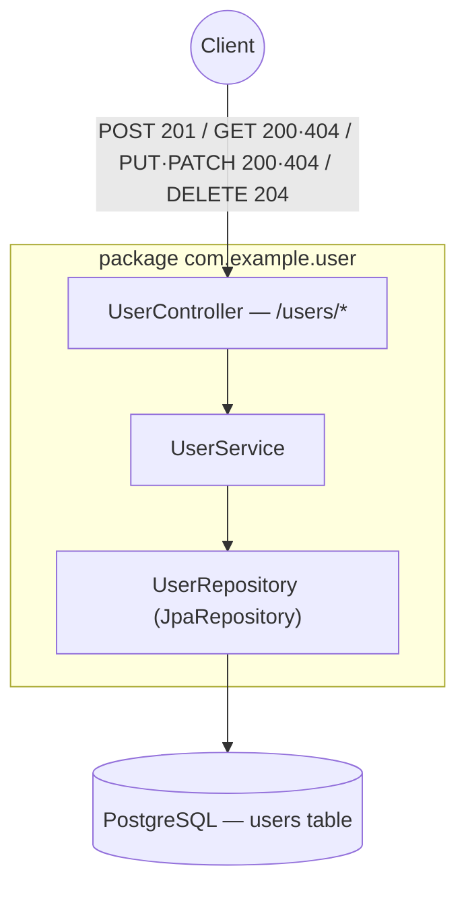

# sortIndex
<!-- @starci/seperator -->
2
<!-- @starci/seperator -->
# lang
<!-- @starci/seperator -->
java
<!-- @starci/seperator -->
# body
<!-- @starci/seperator -->
## 1. Opening

*"For the same `users` resource, how does a client know `POST` creates, `PUT` fully replaces, and `PATCH` only edits part — without reading your docs?"* — a **Senior Engineer** asks. A **Mid-level Developer** replies: *"I'll just use `POST /updateUser`, `POST /deleteUser`, easier to remember."* The answer lacks depth: cramming every operation into `POST` throws away the meaning HTTP already gives you, clients lose the ability to predict behavior, proxies/caches cannot tell which requests are safe to cache or retry, and returning `200` for everything buries `404` errors inside successes.

This lesson ships **Spring Boot** (runs on the host, no Docker). The difference between `POST`, `PUT`, `PATCH`, and `DELETE` is not a preference — it is a contract that clients and proxies rely on:

- **Part 2.1**: **hands-on** runs a CRUD backend for the `users` resource (Spring Data JPA) and calls each endpoint to **observe** the verb → operation mapping and the correct status codes — `201` on create, `200` on read/replace, `204` on delete, `404` when missing.
- **Part 2.2**: **theory** consolidates two foundational concepts — *verb → operation mapping + status code semantics* (the observable contract) and *idempotency* (`PUT` is safe to repeat, `POST` is not) — plus typical **edge cases**.

## 2. Core concepts

This lesson follows **practice-led theory**. Students clone the source, run **Spring Boot** via `mvn spring-boot:run`, and call the API to **observe** each HTTP verb map to a specific CRUD operation, the status code reflect the real outcome, and `PUT` be idempotent while `POST` is not. The theory part then consolidates REST resource semantics, the status code contract, idempotency, and deep edge cases.

### 2.1. Hands-on

#### 2.1.1. Prepare source code and environment

Purpose: run the demo to see the `users` resource respond correctly per verb — `POST` returns `201` with the resource, `GET` returns `200|404`, `PUT` fully replaces vs `PATCH` partially updates, `DELETE` returns `204` with no body.

Source: [StarCi-Academy/fs-3-rest-api-design-and-documentation-0-restful-api-crud-best-practices](https://github.com/StarCi-Academy/fs-3-rest-api-design-and-documentation-0-restful-api-crud-best-practices) on GitHub.

```bash
# Step 1: Clone the repository locally
git clone https://github.com/StarCi-Academy/fs-3-rest-api-design-and-documentation-0-restful-api-crud-best-practices.git

# Step 2: Navigate to the lesson directory
cd fs-3-rest-api-design-and-documentation-0-restful-api-crud-best-practices
```

#### 2.1.2. Architecture / components

The demo has one business resource `users`, layered cleanly with Spring Boot Web + Spring Data JPA:

- `UserController`: maps each HTTP verb (`@PostMapping`/`@GetMapping`/`@PutMapping`/`@PatchMapping`/`@DeleteMapping`) to an operation and sets the status code via `@ResponseStatus` / `ResponseEntity`.
- `UserService`: holds the CRUD logic; throws `ResponseStatusException(404)` when the resource is missing.
- `UserRepository`: `JpaRepository<UserEntity, String>` — DB access, no hand-written SQL.
- `User`: a record `{id, name, email}` — the JSON surface returned to clients.

| Component | File | Role |
| --- | --- | --- |
| `Application` | `src/main/java/com/example/Application.java` | `@SpringBootApplication` — base package + component scan |
| `UserController` | `src/main/java/com/example/user/UserController.java` | Maps verb → operation + sets status code |
| `UserService` | `src/main/java/com/example/user/UserService.java` | CRUD logic; throws `404` when the resource is missing |
| `UserRepository` | `src/main/java/com/example/user/UserRepository.java` | `JpaRepository` accessing the `users` table |
| `User` / `UserEntity` | `.../user/User.java`, `.../user/UserEntity.java` | API record + JPA entity |



Figure 1: One `users` resource — the controller maps verb → operation and sets the status code, the service throws `404` when missing, the repository hits the DB.

#### 2.1.3. Code walkthrough and essence

Focus: *why each verb maps to exactly one operation, why status codes differ across create/read/delete, and why `PUT` is idempotent while `POST` is not*.

##### 2.1.3.1. Verb → operation mapping — `@PostMapping`/`@GetMapping` and the status code

```java
// com.example.user.UserController
@RestController
@RequestMapping("/users")
public class UserController {
    private final UserService userService;

    public UserController(UserService userService) {
        this.userService = userService;
    }

    @GetMapping
    public List<User> findAll() {
        return userService.findAll();
    }

    @PostMapping
    @ResponseStatus(HttpStatus.CREATED)
    public User create(@RequestBody User payload) {
        return userService.create(payload);
    }
}
```

`@GetMapping` maps `GET /users` to the read operation and defaults to `200`. `@PostMapping` maps `POST /users` to the create operation; `@ResponseStatus(HttpStatus.CREATED)` forces a `201` instead of the default `200` — this is exactly the "observable contract": the same URL `/users`, a different verb, leads to a different operation and a different status code. Spring reads the annotations to route and set status, the developer never hand-rolls `if (method == "POST")`.

##### 2.1.3.2. `PUT` full replace vs `PATCH` partial update — and `404` when missing

```java
// com.example.user.UserService
public User update(String id, User payload) {
    // PUT: full replace — fields missing from the payload get overwritten (to defaults)
    UserEntity row = repo.findById(id)
        .orElseThrow(() -> new ResponseStatusException(HttpStatus.NOT_FOUND, "User " + id + " not found"));
    row.setName(payload.name() != null ? payload.name() : "Anonymous");
    row.setEmail(payload.email() != null ? payload.email() : "no-email@example.com");
    return toUser(repo.save(row));
}

public User patch(String id, User payload) {
    // PATCH: only change the fields SENT; null fields keep their previous value
    UserEntity row = repo.findById(id)
        .orElseThrow(() -> new ResponseStatusException(HttpStatus.NOT_FOUND, "User " + id + " not found"));
    if (payload.name() != null) row.setName(payload.name());
    if (payload.email() != null) row.setEmail(payload.email());
    return toUser(repo.save(row));
}
```

`update` (PUT) fully replaces the resource state: a field absent from the payload reverts to its default — sending the same payload repeatedly always yields the same result (idempotent). `patch` (PATCH) only touches the fields sent (`!= null`), leaving the rest intact. Both `orElseThrow` throw `ResponseStatusException(404)` when the id does not exist — the status code is the signal a client uses to distinguish "not found" from "success", not a guess from the body.

##### 2.1.3.3. `DELETE` returns `204` with no body — and why `POST` is not idempotent

```java
// com.example.user.UserController
@DeleteMapping("/{id}")
@ResponseStatus(HttpStatus.NO_CONTENT)
public void remove(@PathVariable String id) {
    userService.remove(id); // throws 404 if no row was deleted
}
```

`@ResponseStatus(HttpStatus.NO_CONTENT)` makes `DELETE` return `204` — signaling "handled, no body". A `void` return ⇒ Spring serializes nothing. The core difference from `POST`: calling `POST /users` twice creates two distinct resources (not idempotent — a new id each time), whereas `PUT /users/{id}` or `DELETE /users/{id}` repeated yields the same final result — the property proxies/retries rely on to retry safely.

> This concept is portable: REST verb semantics + status codes + idempotency are universal HTTP standards, framework-independent. Quick contrast — NestJS uses `@Post()`/`@Put()` + `@HttpCode(201)` + throwing `NotFoundException`, ASP.NET Core uses `[HttpPost]`/`[HttpPut]` + `Results.Created`/`NotFound()`, Go uses an `http.MethodPost`/`MethodPut` switch + `w.WriteHeader(http.StatusCreated)`. Same idea: verbs map to operations, status codes are the observable contract, `PUT`/`DELETE` are idempotent while `POST` is not.

#### 2.1.4. Prerequisites and startup

##### 2.1.4.1. Prerequisites

- **JDK 21** (LTS) and **Maven** (or the bundled `./mvnw` wrapper).
- **PostgreSQL** running and reachable (configured via `spring.datasource.*` in `application.properties`).
- Port **3000** available on the host (set via `server.port=3000` in `application.properties`).
- **Windows:** use `Invoke-RestMethod` instead of `curl`.

##### 2.1.4.2. Start

```bash
# Step 1: Enter directory
cd backend/1-java

# Step 2: Install dependencies
mvn install -DskipTests

# Step 3: Run
mvn spring-boot:run
```

The app listens at `http://localhost:3000`.

#### 2.1.5. Verification

**4 flows** below verify 4 goals:

- **Flow 1 — `POST /users` → `201`:** create a user.
- **Flow 2 — `GET /users/:id` → `200`; missing id → `404`:** read by id.
- **Flow 3 — `PUT /users/:id` then `PATCH /users/:id`:** compare `PUT` (full replace) vs `PATCH` (partial update) → `200`.
- **Flow 4 — `DELETE /users/:id` → `204` with no body:** delete.

::::accordion
:::panel{title="Flow 1 — `POST` creates a resource → `201`"}

- Step 1: call `POST /users` with body `{name, email}`.

  ```bash
  # Windows (PowerShell)
  Invoke-RestMethod -Method Post -Uri "http://localhost:3000/users" -ContentType "application/json" -Body '{"name":"Milo","email":"milo@example.com"}'

  # macOS / Linux
  # → Paste cURL into Postman: Import → Raw text
  curl -s -X POST http://localhost:3000/users -H "Content-Type: application/json" -d '{"name":"Milo","email":"milo@example.com"}'
  ```

  Response should return (HTTP 201):

  ```json
  { "id": "a1b2c3", "name": "Milo", "email": "milo@example.com" }
  ```

*Conclusion: If the response matches the JSON above (status 201), the system confirms:*

- *`POST` maps to the create operation, the server assigns a new `id` and returns `201 Created` with the freshly created resource — not `200`.*

:::
:::panel{title="Flow 2 — `GET` by id → `200` | `404`"}

- Step 1: read the user created in Flow 1 by its `id`.

  ```bash
  # Windows (PowerShell)
  Invoke-RestMethod -Uri "http://localhost:3000/users/a1b2c3"

  # macOS / Linux
  # → Paste cURL into Postman: Import → Raw text
  curl -s http://localhost:3000/users/a1b2c3
  ```

  Response should return (HTTP 200):

  ```json
  { "id": "a1b2c3", "name": "Milo", "email": "milo@example.com" }
  ```

- Step 2: read a non-existent id to observe `404`.

  ```bash
  # Windows (PowerShell)
  Invoke-RestMethod -Uri "http://localhost:3000/users/does-not-exist"

  # macOS / Linux
  # → Paste cURL into Postman: Import → Raw text
  curl -s -i http://localhost:3000/users/does-not-exist
  ```

  Response should return (HTTP 404):

  ```json
  { "status": 404, "error": "Not Found", "message": "User does-not-exist not found" }
  ```

*Conclusion: If the response matches (200 when present, 404 when missing), the system confirms:*

- *`GET` is a read operation; the status code distinguishes "found" (`200`) from "does not exist" (`404`) — the client never guesses from the body.*

:::
:::panel{title="Flow 3 — `PUT` full replace vs `PATCH` partial update → `200`"}

- Step 1: `PUT /users/:id` sending only `name` — the omitted `email` gets overwritten to default.

  ```bash
  # Windows (PowerShell)
  Invoke-RestMethod -Method Put -Uri "http://localhost:3000/users/a1b2c3" -ContentType "application/json" -Body '{"name":"Milo Updated"}'

  # macOS / Linux
  # → Paste cURL into Postman: Import → Raw text
  curl -s -X PUT http://localhost:3000/users/a1b2c3 -H "Content-Type: application/json" -d '{"name":"Milo Updated"}'
  ```

  Response should return (HTTP 200):

  ```json
  { "id": "a1b2c3", "name": "Milo Updated", "email": "no-email@example.com" }
  ```

- Step 2: `PATCH /users/:id` sending only `email` — `name` keeps its current value.

  ```bash
  # Windows (PowerShell)
  Invoke-RestMethod -Method Patch -Uri "http://localhost:3000/users/a1b2c3" -ContentType "application/json" -Body '{"email":"milo@new.com"}'

  # macOS / Linux
  # → Paste cURL into Postman: Import → Raw text
  curl -s -X PATCH http://localhost:3000/users/a1b2c3 -H "Content-Type: application/json" -d '{"email":"milo@new.com"}'
  ```

  Response should return (HTTP 200):

  ```json
  { "id": "a1b2c3", "name": "Milo Updated", "email": "milo@new.com" }
  ```

*Conclusion: If the two responses differ exactly as above, the system confirms:*

- *`PUT` replaces the whole state (the missing field reverts to default → `email` becomes `no-email@example.com`), while `PATCH` changes only the sent field (`name` is kept) — exactly the semantics of the two verbs.*

:::
:::panel{title="Flow 4 — `DELETE` → `204` with no body"}

- Step 1: call `DELETE /users/:id`.

  ```bash
  # Windows (PowerShell)
  Invoke-RestMethod -Method Delete -Uri "http://localhost:3000/users/a1b2c3" -ResponseHeadersVariable h; $h.StatusCode

  # macOS / Linux
  # → Paste cURL into Postman: Import → Raw text
  curl -s -i -X DELETE http://localhost:3000/users/a1b2c3
  ```

  Response should return HTTP 204 with an empty body:

  ```text
  HTTP/1.1 204 No Content
  ```

*Conclusion: If the status is `204` and the body is empty, the system confirms:*

- *`DELETE` maps to the delete operation and returns `204 No Content` — signaling "handled, nothing to return" instead of `200` with a redundant body.*

:::
::::

#### 2.1.6. Cleanup

This lesson does not use Docker, no resource cleanup is needed. Press `Ctrl+C` in the terminal to stop Spring Boot. You may call `DELETE /users/demo/clear-all` (`204`) to wipe seeded data in the `users` table.

#### 2.1.7. Further reading

- **Spring Web MVC — Mapping requests:** how `@GetMapping`/`@PostMapping`... map a verb to a handler. ([Spring — Annotated Controllers](https://docs.spring.io/spring-framework/reference/web/webmvc/mvc-controller/ann-requestmapping.html))
- **Response status:** setting the status code via `@ResponseStatus` and `ResponseEntity`. ([Spring — Handler Methods: Response Status](https://docs.spring.io/spring-framework/reference/web/webmvc/mvc-controller/ann-methods/responsestatus.html))
- **HTTP semantics:** the standard meaning of verbs, status codes, and idempotency. ([RFC 9110 — HTTP Semantics](https://www.rfc-editor.org/rfc/rfc9110))

### 2.2. Theory

#### 2.2.1. The essence

The essence of REST resource semantics comes down to one thing: **HTTP already defines what verbs and status codes mean — a good API *follows* that meaning so the contract is observable, instead of inventing its own conventions**. The three facets below are not three separate concepts but three views of that one essence.

- **Verbs map to operations (POST/GET/PUT/PATCH/DELETE).** Each verb carries a fixed meaning on the same resource: `POST` creates, `GET` reads (safe, no state change), `PUT` fully replaces, `PATCH` partially updates, `DELETE` deletes. Why this is the core and not optional: cramming everything into `POST /doSomething` throws away existing information — clients, proxies, and caches can no longer tell whether a request is safe to cache/retry. Verified in Flow 1 + Flow 3: same URL `/users/:id`, `PUT` and `PATCH` produce different results matching their semantics.
- **Status codes are the observable contract (201/200/204/404).** A status code is how the server "states" the outcome without the client parsing the body: `201` created (with the resource), `200` read/overwrite succeeded, `204` handled with no body (delete), `404` resource does not exist. The essence: status codes live at the protocol layer, so *every* HTTP tool understands them — returning `200` for both errors and successes blinds clients and monitoring. The table below maps verb → operation → status:

| Verb | Operation | Success status | Idempotent |
| --- | --- | --- | --- |
| `POST` | Create a new resource | `201 Created` | No |
| `GET` | Read (safe) | `200 OK` / `404` | Yes |
| `PUT` | Full replace | `200 OK` / `404` | Yes |
| `PATCH` | Partial update | `200 OK` / `404` | Design-dependent |
| `DELETE` | Delete | `204 No Content` / `404` | Yes |

- **Idempotency (PUT/DELETE safe to repeat, POST is not).** Idempotent = calling N times yields the same final result as calling once. `GET`/`PUT`/`DELETE` are idempotent: `PUT` with the same payload always sets the resource to the same state, a second `DELETE` just returns `404` rather than "deleting more". `POST` is not idempotent — each call creates a new resource (a new id, Flow 1). Why it matters: on a flaky network, a client/proxy can retry safely an idempotent request without creating duplicates — the foundation of reliability in distributed systems.

Putting it together: the REST contract = *verb picks the operation + status code reports the outcome + idempotency decides retries*. Learning a new API is exactly reading how it maps these three facets — and a good API does not force you to read docs to guess.

#### 2.2.2. Edge cases to internalize

- **Returning `200` for a create:** the client cannot tell a create from an update. **Solution:** `@ResponseStatus(HttpStatus.CREATED)` on `POST`, return `201` with the resource (ideally add a `Location` header).
- **Using `POST` for every operation (`POST /updateUser`):** discards the semantics, losing cache/retry. **Solution:** map the right verb (`PUT`/`PATCH`/`DELETE`) with the corresponding annotation.
- **Confusing `PUT` and `PATCH`:** sending `PUT` without a field expecting it to be kept, while it is actually overwritten to default. **Solution:** `PUT` = the client sends the *whole* representation; for a partial change use `PATCH`.
- `DELETE` returning `200` with a redundant body: the client is unsure it really deleted. **Solution:** `@ResponseStatus(HttpStatus.NO_CONTENT)` + `void`, return `204` with no body.
- **Swallowing "not found" into a `200`:** monitoring never sees the error. **Solution:** throw `ResponseStatusException(HttpStatus.NOT_FOUND)` to return a semantically correct `404`.

## 3. Wrap-up

### 3.1. Common interview questions

- **Question 1: What is the difference between `PUT` and `PATCH`, and why do status codes matter in REST?**
  - What interviewers want to hear: `PUT` fully replaces the resource (idempotent), `PATCH` updates part of it; status codes are the observable contract at the protocol layer.
  - Sample answer (concise): `PUT` sends the *whole* representation, so omitted fields are overwritten to defaults, and resending the same payload always yields the same state (idempotent). `PATCH` changes only the fields sent. Status codes (`201` create, `200` read/write, `204` delete, `404` missing) tell the client and every HTTP tool the outcome without parsing the body — returning `200` for everything blinds monitoring and caches.
- **Question 2: In Spring Boot, how do you return `201` for `POST` and `204` for `DELETE` instead of the default `200`?**
  - What interviewers want to hear: use `@ResponseStatus` (or `ResponseEntity`) to set the status code explicitly and semantically.
  - Sample answer (concise): Spring defaults to `200`. Put `@ResponseStatus(HttpStatus.CREATED)` on the `@PostMapping` handler to return `201` with the resource, and `@ResponseStatus(HttpStatus.NO_CONTENT)` on `@DeleteMapping` with a `void` method to return `204` with no body. When you need runtime flexibility, use `ResponseEntity.status(...)`. If the resource is missing, throw `ResponseStatusException(HttpStatus.NOT_FOUND)` for a `404`.
- **Question 3: What is idempotency and why does it matter for retries?**
  - What interviewers want to hear: calling N times yields the same result as once; `PUT`/`DELETE`/`GET` are idempotent, `POST` is not; the foundation for safe retries.
  - Sample answer (concise): An idempotent operation called multiple times yields the same final result as a single call. `GET` (no state change), `PUT` (sets the resource to the same state), and `DELETE` (a second call just returns `404`) are idempotent; `POST` is not because each call creates a new resource with a new id. Thanks to idempotency, on a timeout or flaky network a client/proxy can retry `PUT`/`DELETE` safely without creating duplicates — something `POST` does not guarantee.
<!-- @starci/seperator -->
