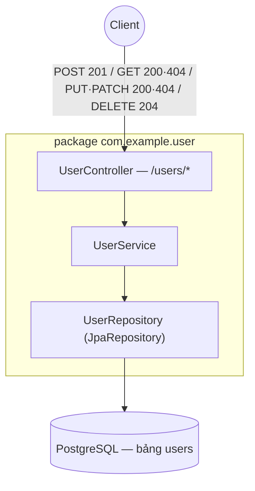

# sortIndex
<!-- @starci/seperator -->
2
<!-- @starci/seperator -->
# lang
<!-- @starci/seperator -->
java
<!-- @starci/seperator -->
# body
<!-- @starci/seperator -->
## 1. Lời mở đầu

*"Cùng một resource `users`, vì sao client biết `POST` là tạo, `PUT` là thay toàn bộ, còn `PATCH` chỉ sửa một phần — mà không cần đọc tài liệu của bạn?"* — một **Senior Engineer** hỏi. **Mid-level Developer** đáp: *"Em đặt `POST /updateUser`, `POST /deleteUser` cho dễ nhớ là được."* Câu trả lời thiếu chiều sâu: gói mọi thao tác vào `POST` vứt bỏ ngữ nghĩa HTTP có sẵn, client mất khả năng đoán hành vi, proxy/cache không biết request nào an toàn để cache hay retry, và status code trả về `200` cho mọi thứ khiến lỗi `404` lẫn vào thành công.

Bài học triển khai **Spring Boot** (chạy trên host, không Docker). Điểm khác biệt giữa `POST`, `PUT`, `PATCH` và `DELETE` không phải tuỳ chọn mà là hợp đồng mà client và proxy dựa vào:

- **Phần 2.1**: **thực hành** chạy một backend CRUD resource `users` (Spring Data JPA) và gọi từng endpoint để **quan sát** ánh xạ verb → thao tác và status code đúng chuẩn — `201` khi tạo, `200` khi đọc/ghi-đè, `204` khi xóa, `404` khi không thấy.
- **Phần 2.2**: **lý thuyết** hệ thống hoá hai khái niệm nền tảng — *ánh xạ verb → thao tác + ngữ nghĩa status code* (contract quan sát được) và *idempotency* (`PUT` lặp lại an toàn, `POST` thì không) — kèm các **edge case** điển hình.

## 2. Các khái niệm cốt lõi

Bài tuân theo **Thực hành dẫn dắt Lý thuyết**. Học viên clone source, chạy **Spring Boot** bằng `mvn spring-boot:run` và gọi API để **quan sát** mỗi HTTP verb ánh xạ tới một thao tác CRUD cụ thể, status code phản ánh đúng kết quả, và `PUT` **idempotent** trong khi `POST` thì không. Sau đó phần lý thuyết hệ thống hoá REST resource semantics, status code contract, idempotency và phân tích các edge case chuyên sâu.

### 2.1. Thực hành

#### 2.1.1. Chuẩn bị source code và môi trường

Mục đích: chạy demo để thấy resource `users` phản hồi đúng từng verb — `POST` trả `201` kèm resource, `GET` trả `200|404`, `PUT` thay toàn bộ vs `PATCH` sửa một phần, `DELETE` trả `204` không body.

Source: [StarCi-Academy/fs-3-rest-api-design-and-documentation-0-restful-api-crud-best-practices](https://github.com/StarCi-Academy/fs-3-rest-api-design-and-documentation-0-restful-api-crud-best-practices) trên GitHub.

```bash
# Step 1: Clone the repository locally
git clone https://github.com/StarCi-Academy/fs-3-rest-api-design-and-documentation-0-restful-api-crud-best-practices.git

# Bước 2: Di chuyển vào đúng thư mục bài học
cd fs-3-rest-api-design-and-documentation-0-restful-api-crud-best-practices
```

#### 2.1.2. Kiến trúc / thành phần

Demo có một resource nghiệp vụ `users`, tách tầng rõ ràng theo Spring Boot Web + Spring Data JPA:

- `UserController`: ánh xạ mỗi HTTP verb (`@PostMapping`/`@GetMapping`/`@PutMapping`/`@PatchMapping`/`@DeleteMapping`) tới một thao tác, đặt status code qua `@ResponseStatus` / `ResponseEntity`.
- `UserService`: chứa nghiệp vụ CRUD; ném `ResponseStatusException(404)` khi không tìm thấy resource.
- `UserRepository`: `JpaRepository<UserEntity, String>` — truy cập DB, không viết SQL tay.
- `User`: record `{id, name, email}` — bề mặt JSON trả client.

| Thành phần | File | Vai trò |
| --- | --- | --- |
| `Application` | `src/main/java/com/example/Application.java` | `@SpringBootApplication` — base package + component scan |
| `UserController` | `src/main/java/com/example/user/UserController.java` | Ánh xạ verb → thao tác + đặt status code |
| `UserService` | `src/main/java/com/example/user/UserService.java` | Nghiệp vụ CRUD, ném `404` khi thiếu resource |
| `UserRepository` | `src/main/java/com/example/user/UserRepository.java` | `JpaRepository` truy cập bảng `users` |
| `User` / `UserEntity` | `.../user/User.java`, `.../user/UserEntity.java` | Record API + entity JPA |



Hình 1: Một resource `users` — controller ánh xạ verb → thao tác và đặt status code, service ném `404` khi thiếu, repository chạm DB.

#### 2.1.3. Giải thích code và bản chất

Trọng tâm: *vì sao mỗi verb ánh xạ tới đúng một thao tác, vì sao status code khác nhau giữa tạo/đọc/xóa, và vì sao `PUT` idempotent còn `POST` thì không*.

##### 2.1.3.1. Ánh xạ verb → thao tác — `@PostMapping`/`@GetMapping` và status code

```java
// com.example.user.UserController
@RestController
@RequestMapping("/users")
public class UserController {
    private final UserService userService;

    public UserController(UserService userService) {
        this.userService = userService;
    }

    @GetMapping
    public List<User> findAll() {
        return userService.findAll();
    }

    @PostMapping
    @ResponseStatus(HttpStatus.CREATED)
    public User create(@RequestBody User payload) {
        return userService.create(payload);
    }
}
```

`@GetMapping` ánh xạ `GET /users` tới thao tác đọc và mặc định trả `200`. `@PostMapping` ánh xạ `POST /users` tới thao tác tạo; `@ResponseStatus(HttpStatus.CREATED)` ép status `201` thay vì `200` mặc định — đây chính là phần "contract quan sát được": cùng một URL `/users`, verb khác nhau dẫn tới thao tác khác nhau và status code khác nhau. Spring đọc annotation để route và set status, dev không tự ghép `if (method == "POST")`.

##### 2.1.3.2. `PUT` thay toàn bộ vs `PATCH` sửa một phần — và `404` khi thiếu

```java
// com.example.user.UserService
public User update(String id, User payload) {
    // PUT: full replace — fields missing from the payload get overwritten (to defaults)
    UserEntity row = repo.findById(id)
        .orElseThrow(() -> new ResponseStatusException(HttpStatus.NOT_FOUND, "User " + id + " not found"));
    row.setName(payload.name() != null ? payload.name() : "Anonymous");
    row.setEmail(payload.email() != null ? payload.email() : "no-email@example.com");
    return toUser(repo.save(row));
}

public User patch(String id, User payload) {
    // PATCH: only change the fields SENT; null fields keep their previous value
    UserEntity row = repo.findById(id)
        .orElseThrow(() -> new ResponseStatusException(HttpStatus.NOT_FOUND, "User " + id + " not found"));
    if (payload.name() != null) row.setName(payload.name());
    if (payload.email() != null) row.setEmail(payload.email());
    return toUser(repo.save(row));
}
```

`update` (PUT) thay toàn bộ state của resource: field không có trong payload bị đưa về default — gửi lại đúng payload đó nhiều lần luôn cho cùng kết quả (idempotent). `patch` (PATCH) chỉ chạm field được gửi (`!= null`), giữ nguyên phần còn lại. Cả hai `orElseThrow` ném `ResponseStatusException(404)` khi id không tồn tại — status code chính là tín hiệu để client phân biệt "không thấy" với "thành công", không phải đoán qua body.

##### 2.1.3.3. `DELETE` trả `204` không body — và vì sao `POST` không idempotent

```java
// com.example.user.UserController
@DeleteMapping("/{id}")
@ResponseStatus(HttpStatus.NO_CONTENT)
public void remove(@PathVariable String id) {
    userService.remove(id); // throws 404 if no row was deleted
}
```

`@ResponseStatus(HttpStatus.NO_CONTENT)` cho `DELETE` trả `204` — báo "đã xử lý, không có body". `void` return ⇒ Spring không serialize gì. Khác biệt cốt lõi với `POST`: gọi `POST /users` hai lần tạo hai resource khác nhau (không idempotent — mỗi lần một id mới), trong khi `PUT /users/{id}` hay `DELETE /users/{id}` lặp lại cho cùng kết quả cuối — đây là tính chất proxy/retry dựa vào để retry an toàn.

> Khái niệm này portable: REST verb semantics + status code + idempotency là chuẩn HTTP phổ quát, không phụ thuộc framework. Đối chiếu ngắn — NestJS dùng `@Post()`/`@Put()` + `@HttpCode(201)` + ném `NotFoundException`, ASP.NET Core dùng `[HttpPost]`/`[HttpPut]` + `Results.Created`/`NotFound()`, Go dùng `http.MethodPost`/`MethodPut` switch + `w.WriteHeader(http.StatusCreated)`. Đều chung ý: verb ánh xạ thao tác, status code là contract quan sát được, `PUT`/`DELETE` idempotent còn `POST` thì không.

#### 2.1.4. Chuẩn bị & khởi chạy

##### 2.1.4.1. Điều kiện cần trước

- **JDK 21** (LTS) và **Maven** (hoặc dùng `./mvnw` wrapper kèm repo).
- **PostgreSQL** đang chạy và reachable (cấu hình `spring.datasource.*` trong `application.properties`).
- Port **3000** sẵn sàng trên host (cấu hình `server.port=3000` trong `application.properties`).
- **Windows:** dùng `Invoke-RestMethod` thay cho `curl`.

##### 2.1.4.2. Khởi động

```bash
# Bước 1: Vào thư mục
cd backend/1-java

# Bước 2: Cài dependency
mvn install -DskipTests

# Bước 3: Chạy
mvn spring-boot:run
```

App lắng nghe tại `http://localhost:3000`.

#### 2.1.5. Kiểm thử

**4 luồng** dưới đây kiểm chứng 4 mục tiêu:

- **Luồng 1 — `POST /users` → `201`:** tạo user.
- **Luồng 2 — `GET /users/:id` → `200`; id không tồn tại → `404`:** đọc theo id.
- **Luồng 3 — `PUT /users/:id` rồi `PATCH /users/:id`:** so sánh `PUT` (thay toàn bộ) vs `PATCH` (sửa một phần) → `200`.
- **Luồng 4 — `DELETE /users/:id` → `204` không body:** xóa.

::::accordion
:::panel{title="Luồng 1 — `POST` tạo resource → `201`"}

- Bước 1: gọi `POST /users` với body `{name, email}`.

  ```bash
  # Windows (PowerShell)
  Invoke-RestMethod -Method Post -Uri "http://localhost:3000/users" -ContentType "application/json" -Body '{"name":"Milo","email":"milo@example.com"}'

  # macOS / Linux
  # → Paste cURL into Postman: Import → Raw text
  curl -s -X POST http://localhost:3000/users -H "Content-Type: application/json" -d '{"name":"Milo","email":"milo@example.com"}'
  ```

  Response phải trả về (HTTP 201):

  ```json
  { "id": "a1b2c3", "name": "Milo", "email": "milo@example.com" }
  ```

*Kết luận: Nếu response khớp JSON trên (status 201), hệ thống xác nhận:*

- *`POST` ánh xạ tới thao tác tạo, server cấp `id` mới và trả status `201 Created` kèm resource vừa tạo — không phải `200`.*

:::
:::panel{title="Luồng 2 — `GET` theo id → `200` | `404`"}

- Bước 1: đọc user vừa tạo bằng `id` ở Luồng 1.

  ```bash
  # Windows (PowerShell)
  Invoke-RestMethod -Uri "http://localhost:3000/users/a1b2c3"

  # macOS / Linux
  # → Paste cURL into Postman: Import → Raw text
  curl -s http://localhost:3000/users/a1b2c3
  ```

  Response phải trả về (HTTP 200):

  ```json
  { "id": "a1b2c3", "name": "Milo", "email": "milo@example.com" }
  ```

- Bước 2: đọc một id không tồn tại để thấy `404`.

  ```bash
  # Windows (PowerShell)
  Invoke-RestMethod -Uri "http://localhost:3000/users/does-not-exist"

  # macOS / Linux
  # → Paste cURL into Postman: Import → Raw text
  curl -s -i http://localhost:3000/users/does-not-exist
  ```

  Response phải trả về (HTTP 404):

  ```json
  { "status": 404, "error": "Not Found", "message": "User does-not-exist not found" }
  ```

*Kết luận: Nếu response khớp (200 khi có, 404 khi thiếu), hệ thống xác nhận:*

- *`GET` là thao tác đọc; status code phân biệt "tìm thấy" (`200`) với "không tồn tại" (`404`) — client không phải đoán qua body.*

:::
:::panel{title="Luồng 3 — `PUT` thay toàn bộ vs `PATCH` sửa một phần → `200`"}

- Bước 1: `PUT /users/:id` chỉ gửi `name` — `email` không gửi sẽ bị ghi đè về default.

  ```bash
  # Windows (PowerShell)
  Invoke-RestMethod -Method Put -Uri "http://localhost:3000/users/a1b2c3" -ContentType "application/json" -Body '{"name":"Milo Updated"}'

  # macOS / Linux
  # → Paste cURL into Postman: Import → Raw text
  curl -s -X PUT http://localhost:3000/users/a1b2c3 -H "Content-Type: application/json" -d '{"name":"Milo Updated"}'
  ```

  Response phải trả về (HTTP 200):

  ```json
  { "id": "a1b2c3", "name": "Milo Updated", "email": "no-email@example.com" }
  ```

- Bước 2: `PATCH /users/:id` chỉ gửi `email` — `name` giữ nguyên giá trị hiện tại.

  ```bash
  # Windows (PowerShell)
  Invoke-RestMethod -Method Patch -Uri "http://localhost:3000/users/a1b2c3" -ContentType "application/json" -Body '{"email":"milo@new.com"}'

  # macOS / Linux
  # → Paste cURL into Postman: Import → Raw text
  curl -s -X PATCH http://localhost:3000/users/a1b2c3 -H "Content-Type: application/json" -d '{"email":"milo@new.com"}'
  ```

  Response phải trả về (HTTP 200):

  ```json
  { "id": "a1b2c3", "name": "Milo Updated", "email": "milo@new.com" }
  ```

*Kết luận: Nếu hai response khác nhau đúng như trên, hệ thống xác nhận:*

- *`PUT` thay toàn bộ state (field thiếu về default → `email` thành `no-email@example.com`), còn `PATCH` chỉ đổi field được gửi (`name` được giữ) — đúng ngữ nghĩa hai verb.*

:::
:::panel{title="Luồng 4 — `DELETE` → `204` không body"}

- Bước 1: gọi `DELETE /users/:id`.

  ```bash
  # Windows (PowerShell)
  Invoke-RestMethod -Method Delete -Uri "http://localhost:3000/users/a1b2c3" -ResponseHeadersVariable h; $h.StatusCode

  # macOS / Linux
  # → Paste cURL into Postman: Import → Raw text
  curl -s -i -X DELETE http://localhost:3000/users/a1b2c3
  ```

  Response phải trả về HTTP 204 với body rỗng:

  ```text
  HTTP/1.1 204 No Content
  ```

*Kết luận: Nếu status là `204` và body rỗng, hệ thống xác nhận:*

- *`DELETE` ánh xạ tới thao tác xóa và trả `204 No Content` — báo "đã xử lý, không có gì để trả" thay vì `200` kèm body thừa.*

:::
::::

#### 2.1.6. Dọn tài nguyên

Bài này không sử dụng Docker, không cần dọn tài nguyên. Nhấn `Ctrl+C` trong terminal để dừng Spring Boot. Có thể gọi `DELETE /users/demo/clear-all` (`204`) để dọn dữ liệu seed trong bảng `users`.

#### 2.1.7. Đọc thêm

- **Spring Web MVC — Mapping requests:** cách `@GetMapping`/`@PostMapping`... ánh xạ verb tới handler. ([Spring — Annotated Controllers](https://docs.spring.io/spring-framework/reference/web/webmvc/mvc-controller/ann-requestmapping.html))
- **Response status:** đặt status code qua `@ResponseStatus` và `ResponseEntity`. ([Spring — Handler Methods: Response Status](https://docs.spring.io/spring-framework/reference/web/webmvc/mvc-controller/ann-methods/responsestatus.html))
- **HTTP semantics:** ngữ nghĩa verb, status code và idempotency chuẩn HTTP. ([RFC 9110 — HTTP Semantics](https://www.rfc-editor.org/rfc/rfc9110))

### 2.2. Lý thuyết

#### 2.2.1. Bản chất

Bản chất của REST resource semantics gói gọn trong một điều: **HTTP đã định nghĩa sẵn ý nghĩa của verb và status code — API tốt là API *tuân theo* ngữ nghĩa đó để contract quan sát được, chứ không tự bịa quy ước riêng**. Ba mặt dưới đây không phải ba khái niệm rời rạc mà là ba góc nhìn của cùng một bản chất đó.

- **Verb ánh xạ thao tác (POST/GET/PUT/PATCH/DELETE).** Mỗi verb mang một ý nghĩa cố định trên cùng một resource: `POST` tạo, `GET` đọc (an toàn, không đổi state), `PUT` thay toàn bộ, `PATCH` sửa một phần, `DELETE` xóa. Vì sao điều này là cốt lõi chứ không phải tùy chọn: nhồi mọi thứ vào `POST /doSomething` vứt bỏ thông tin có sẵn — client, proxy và cache không còn đoán được request có an toàn để cache/retry hay không. Kiểm chứng ở Luồng 1 + Luồng 3: cùng URL `/users/:id`, `PUT` và `PATCH` cho kết quả khác nhau đúng ngữ nghĩa.
- **Status code là contract quan sát được (201/200/204/404).** Status code là cách server "nói" kết quả mà không cần client parse body: `201` tạo mới (kèm resource), `200` đọc/ghi-đè thành công, `204` xử lý xong không body (xóa), `404` resource không tồn tại. Bản chất: status code thuộc lớp giao thức nên *mọi* tooling HTTP hiểu nó — trả `200` cho cả lỗi lẫn thành công làm mù client và monitoring. Bảng dưới gom verb → thao tác → status:

| Verb | Thao tác | Status thành công | Idempotent |
| --- | --- | --- | --- |
| `POST` | Tạo resource mới | `201 Created` | Không |
| `GET` | Đọc (an toàn) | `200 OK` / `404` | Có |
| `PUT` | Thay toàn bộ | `200 OK` / `404` | Có |
| `PATCH` | Sửa một phần | `200 OK` / `404` | Tùy thiết kế |
| `DELETE` | Xóa | `204 No Content` / `404` | Có |

- **Idempotency (PUT/DELETE an toàn lặp, POST thì không).** Idempotent = gọi N lần cho cùng kết quả cuối như gọi 1 lần. `GET`/`PUT`/`DELETE` idempotent: `PUT` cùng payload luôn đặt resource về cùng state, `DELETE` lần 2 chỉ trả `404` chứ không "xóa thêm". `POST` không idempotent — mỗi lần tạo một resource mới (id mới, Luồng 1). Vì sao quan trọng: khi mạng chập chờn, client/proxy có thể retry an toàn request idempotent mà không sợ tạo trùng — nền tảng cho reliability của hệ thống phân tán.

Gộp lại: REST contract = *verb chọn thao tác + status code báo kết quả + idempotency quyết định retry*. Hiểu một API mới chính là đọc xem nó ánh xạ ba mặt này thế nào — và API tốt thì không bắt bạn đọc tài liệu để đoán.

#### 2.2.2. Các trường hợp biên (edge cases) cần lưu ý

- **Trả `200` cho thao tác tạo:** client không phân biệt được tạo mới với cập nhật. **Giải pháp:** `@ResponseStatus(HttpStatus.CREATED)` cho `POST`, trả `201` kèm resource (lý tưởng thêm header `Location`).
- **Dùng `POST` cho mọi thao tác (`POST /updateUser`):** vứt bỏ ngữ nghĩa, mất khả năng cache/retry. **Giải pháp:** ánh xạ đúng verb (`PUT`/`PATCH`/`DELETE`) bằng annotation tương ứng.
- **Lẫn lộn `PUT` và `PATCH`:** gửi `PUT` thiếu field tưởng giữ giá trị cũ nhưng thực ra bị ghi đè về default. **Giải pháp:** `PUT` = client gửi *toàn bộ* representation; cần sửa một phần thì dùng `PATCH`.
- `DELETE` trả `200` kèm body thừa: client không rõ đã thật sự xóa. **Giải pháp:** `@ResponseStatus(HttpStatus.NO_CONTENT)` + `void`, trả `204` không body.
- **Nuốt lỗi "không tìm thấy" thành `200`:** monitoring không thấy lỗi. **Giải pháp:** ném `ResponseStatusException(HttpStatus.NOT_FOUND)` để trả `404` đúng ngữ nghĩa.

## 3. Tổng kết

### 3.1. Các câu hỏi dễ bị phỏng vấn

- **Câu hỏi 1: Khác biệt giữa `PUT` và `PATCH` là gì, và vì sao status code lại quan trọng trong REST?**
  - Ý interviewer muốn nghe: `PUT` thay toàn bộ resource (idempotent), `PATCH` sửa một phần; status code là contract quan sát được ở lớp giao thức.
  - Trả lời mẫu (ngắn): `PUT` gửi *toàn bộ* representation nên field thiếu bị ghi đè về default, gọi lại cùng payload luôn cho cùng state (idempotent). `PATCH` chỉ đổi field được gửi. Status code (`201` tạo, `200` đọc/ghi, `204` xóa, `404` thiếu) cho client và mọi tooling HTTP biết kết quả mà không cần parse body — trả `200` cho tất cả làm mù monitoring và cache.
- **Câu hỏi 2: Trong Spring Boot, làm sao trả `201` cho `POST` và `204` cho `DELETE` thay vì `200` mặc định?**
  - Ý interviewer muốn nghe: dùng `@ResponseStatus` (hoặc `ResponseEntity`) để đặt status code rõ ràng đúng ngữ nghĩa.
  - Trả lời mẫu (ngắn): Mặc định Spring trả `200`. Đặt `@ResponseStatus(HttpStatus.CREATED)` trên handler `@PostMapping` để trả `201` kèm resource, và `@ResponseStatus(HttpStatus.NO_CONTENT)` trên `@DeleteMapping` với method trả `void` để trả `204` không body. Khi cần linh hoạt theo runtime thì dùng `ResponseEntity.status(...)`. Resource không tồn tại thì ném `ResponseStatusException(HttpStatus.NOT_FOUND)` cho `404`.
- **Câu hỏi 3: Idempotency là gì và vì sao nó quan trọng cho retry?**
  - Ý interviewer muốn nghe: gọi N lần cho cùng kết quả như 1 lần; `PUT`/`DELETE`/`GET` idempotent, `POST` thì không; nền tảng cho retry an toàn.
  - Trả lời mẫu (ngắn): Một thao tác idempotent gọi nhiều lần cho cùng kết quả cuối như gọi một lần. `GET` (không đổi state), `PUT` (đặt resource về cùng state), `DELETE` (lần 2 chỉ `404`) là idempotent; `POST` thì không vì mỗi lần tạo resource mới với id mới. Nhờ idempotency, khi timeout hoặc mạng chập chờn, client/proxy có thể retry `PUT`/`DELETE` an toàn mà không tạo trùng — điều `POST` không đảm bảo.
<!-- @starci/seperator -->
