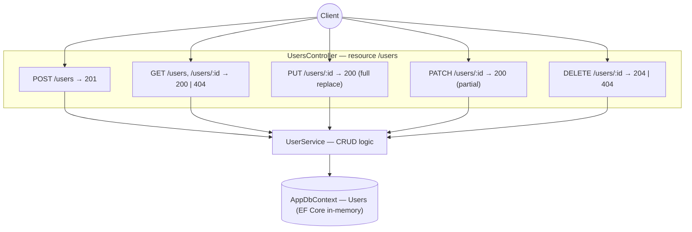

# sortIndex
<!-- @starci/seperator -->
3
<!-- @starci/seperator -->
# lang
<!-- @starci/seperator -->
csharp
<!-- @starci/seperator -->
# body
<!-- @starci/seperator -->
## 1. Opening

*"Why is calling `PUT` twice safe but `POST` is not, and how does a client know how a request succeeded without reading the body?"* — a **Senior Engineer** asks. A **Mid-level Developer** replies: *"I just return 200 with a `success: true` message for every operation."* The answer lacks depth: collapsing everything into 200 throws away the information layer the HTTP protocol already standardized — the client cannot tell "created" (201) from "read" (200) or "deleted, empty body" (204), cannot learn "no such resource" (404) to stop retrying, and hides whether a verb is idempotent or not.

This lesson ships a REST API managing `users` with **ASP.NET Core Web API + EF Core** (runs on the host, no Docker):

- **Part 2.1**: **hands-on** runs the backend and calls each verb to **observe** the actual status code and body — not a home-grown flag.
- **Part 2.2**: **theory** consolidates the essence of REST resource semantics: the verb → operation mapping, what a status code tells the client, and why idempotency is an *intrinsic property* of a verb rather than an option — plus typical **edge cases**.

## 2. Core concepts

This lesson follows **practice-led theory**. Students clone the source, run **ASP.NET Core Web API** via `dotnet run`, and call each endpoint to **observe** every HTTP verb map to exactly one CRUD operation, each result reflected through a status code (201/200/204/404), and directly compare PUT (full replace) with PATCH (partial update). The theory part then consolidates resource semantics, the status code contract, and **idempotency**, plus deep edge cases.

### 2.1. Hands-on

#### 2.1.1. Prepare source code and environment

Purpose: run the demo to see each HTTP verb return the contracted status code and matching body — and to compare PUT against PATCH on the same resource.

Source: [StarCi-Academy/fs-3-rest-api-design-and-documentation-0-restful-api-crud-best-practices](https://github.com/StarCi-Academy/fs-3-rest-api-design-and-documentation-0-restful-api-crud-best-practices) on GitHub.

```bash
# Step 1: Clone the repository locally
git clone https://github.com/StarCi-Academy/fs-3-rest-api-design-and-documentation-0-restful-api-crud-best-practices.git

# Step 2: Navigate to the lesson directory
cd fs-3-rest-api-design-and-documentation-0-restful-api-crud-best-practices
```

#### 2.1.2. Architecture / components

The demo is a thin REST API around the `users` resource, using EF Core with the in-memory provider for zero-config runs:

- `UsersController`: the HTTP adapter — maps each verb (`GET`/`POST`/`PUT`/`PATCH`/`DELETE`) to an action and sets the right status code via the returned `Results`.
- `UserService`: CRUD logic — kept out of the controller, throws `KeyNotFoundException` when an id is missing.
- `AppDbContext`: the EF Core `DbContext` — in-memory `Users` table.
- `User`: flat model `{ id, name, email }` — the JSON contract returned to clients.

| Component | File | Role |
| --- | --- | --- |
| `UsersController` | `Controllers/UsersController.cs` | Map verb → action + status code (201/200/204/404) |
| `UserService` | `Services/UserService.cs` | CRUD logic; distinguishes PUT vs PATCH |
| `AppDbContext` | `Data/AppDbContext.cs` | EF Core context, `Users` table |
| `User` | `Models/User.cs` | Resource model `{ id, name, email }` |



Figure 1: Each HTTP verb maps to one operation on the `users` resource; the status code reflects the result; the service keeps business logic out of the controller.

#### 2.1.3. Code walkthrough and essence

Focus: *why each verb maps to a specific operation, which status code goes with which operation, and why PUT is idempotent but POST is not*.

##### 2.1.3.1. POST creates a resource — 201 Created, not idempotent

```csharp
// Controllers/UsersController.cs
[HttpPost]
public IResult Create([FromBody] UserInput input)
{
    var created = _service.Create(input.Name, input.Email);
    return Results.Created($"/users/{created.Id}", created);
}
```

`POST /users` creates a *new* resource on every call: `Results.Created` sets HTTP 201 with the body of the resource just created. That is why POST is not **idempotent** — calling it twice produces two users with two different ids. The 201 status (not 200) tells the client "a new resource was created", clearly distinct from a read.

##### 2.1.3.2. GET reads a resource — 200 when present, 404 when missing

```csharp
// Controllers/UsersController.cs
[HttpGet]
public IResult FindAll() => Results.Ok(_service.FindAll());

[HttpGet("{id}")]
public IResult FindOne(string id)
{
    var user = _service.FindOne(id); // throws KeyNotFoundException if missing
    return Results.Ok(user);
}
```

`GET` only reads, never changes state (safe). Resource present → HTTP 200 + body. Id missing → the service throws `KeyNotFoundException`, which an exception handler translates into HTTP 404. Returning 404 (rather than 200 with an empty body) tells the client exactly "this resource does not exist" so it can stop retrying or render correctly.

##### 2.1.3.3. PUT full replace vs PATCH partial — both 200 but different semantics

```csharp
// Services/UserService.cs
// PUT: replace EVERYTHING — fields not sent reset to default
public User Replace(string id, string name, string email)
{
    var row = _db.Users.Find(id) ?? throw new KeyNotFoundException(id);
    row.Name = name;   // replace whole field
    row.Email = email; // replace whole field
    _db.SaveChanges();
    return row;
}

// PATCH: change only the SENT fields — omitted fields stay
public User Patch(string id, string? name, string? email)
{
    var row = _db.Users.Find(id) ?? throw new KeyNotFoundException(id);
    if (name is not null) row.Name = name;
    if (email is not null) row.Email = email;
    _db.SaveChanges();
    return row;
}
```

Both return HTTP 200, but the semantics differ sharply: PUT replaces the whole representation (omit a field → that field returns to default), so PUT is **idempotent** — replaying the same payload yields the same result. PATCH partially updates (only sent fields change). This is the core distinction many people confuse: PUT is not "update", it is "replace".

##### 2.1.3.4. DELETE removes a resource — 204 No Content

```csharp
// Controllers/UsersController.cs
[HttpDelete("{id}")]
public IResult Remove(string id)
{
    _service.Remove(id); // throws KeyNotFoundException if missing
    return Results.NoContent();
}
```

`DELETE /users/:id` on success → HTTP 204 No Content: no body because there is nothing left to return. Missing id → 404. Choosing 204 (instead of 200 with a message) is REST's way of saying "the operation succeeded, there is no content to return" — the client need not parse a body.

> This concept is portable: REST resource semantics + status codes + idempotency are HTTP standards (RFC 9110), not framework-bound. Short comparison — NestJS uses `@Post/@Get/@Put/@Patch/@Delete` + `@HttpCode`, Spring uses `@PostMapping/...` + `ResponseEntity`, Go uses `http.MethodPost/...` on a router (chi/gin) + `w.WriteHeader`. Same verb → operation → status code mapping; only the declaration syntax differs.

#### 2.1.4. Prepare and run

##### 2.1.4.1. Prerequisites

- **.NET SDK 8** (LTS).
- Port **3000** available on the host (set via `app.Run("http://localhost:3000")` or `launchSettings.json`).
- **Windows:** use `Invoke-RestMethod` instead of `curl`.

##### 2.1.4.2. Start

```bash
# Step 1: Enter directory
cd backend/2-csharp

# Step 2: Install dependencies
dotnet restore

# Step 3: Run
dotnet watch run
```

The app listens at `http://localhost:3000`.

#### 2.1.5. Testing

The **4 flows** below verify 4 goals:

- **Flow 1 — `POST /users`:** create a user.
- **Flow 2 — `GET /users/:id`:** read by id and read a missing id.
- **Flow 3 — `PUT`/`PATCH /users/:id`:** compare PUT (full replace) with PATCH (partial).
- **Flow 4 — `DELETE /users/:id`:** delete a user. Run them in order because later flows use the id produced earlier.

::::accordion
:::panel{title="Flow 1 — POST creates a resource → 201"}

- Step 1: call `POST /users` with a name/email body.

  ```bash
  # Windows (PowerShell)
  Invoke-RestMethod -Uri "http://localhost:3000/users" -Method Post -ContentType "application/json" -Body '{"name":"Milo","email":"milo@example.com"}'

  # macOS / Linux
  # → Paste the cURL into Postman: Import → Raw text
  curl -s -X POST http://localhost:3000/users -H "Content-Type: application/json" -d '{"name":"Milo","email":"milo@example.com"}'
  ```

  The response must be (HTTP 201):

  ```json
  { "id": "u1", "name": "Milo", "email": "milo@example.com" }
  ```

*Conclusion: if the response matches the JSON above with status 201, the system confirms:*

- *POST maps to the create operation; the server returns 201 Created with the new resource's representation (id assigned by the server).*

:::
:::panel{title="Flow 2 — GET read: 200 when present, 404 when missing"}

- Step 1: read the user just created `GET /users/u1`.

  ```bash
  # Windows (PowerShell)
  Invoke-RestMethod -Uri "http://localhost:3000/users/u1"

  # macOS / Linux
  # → Paste the cURL into Postman: Import → Raw text
  curl -s http://localhost:3000/users/u1
  ```

  The response must be (HTTP 200):

  ```json
  { "id": "u1", "name": "Milo", "email": "milo@example.com" }
  ```

- Step 2: read a missing id `GET /users/nope`.

  ```bash
  # Windows (PowerShell)
  Invoke-RestMethod -Uri "http://localhost:3000/users/nope"

  # macOS / Linux
  # → Paste the cURL into Postman: Import → Raw text
  curl -s -o /dev/null -w "%{http_code}" http://localhost:3000/users/nope
  ```

  The response must be (HTTP 404):

  ```json
  { "message": "User with ID nope not found" }
  ```

*Conclusion: if both responses match, the system confirms:*

- *GET is safe (read-only); resource present → 200 + body, resource missing → 404 so the client knows to stop, not mistaking it for an empty body.*

:::
:::panel{title="Flow 3 — PUT (full replace) vs PATCH (partial)"}

- Step 1: `PUT /users/u1` sending only `name` — observe `email` reset (full replace).

  ```bash
  # Windows (PowerShell)
  Invoke-RestMethod -Uri "http://localhost:3000/users/u1" -Method Put -ContentType "application/json" -Body '{"name":"Milo Renamed"}'

  # macOS / Linux
  # → Paste the cURL into Postman: Import → Raw text
  curl -s -X PUT http://localhost:3000/users/u1 -H "Content-Type: application/json" -d '{"name":"Milo Renamed"}'
  ```

  The response must be (HTTP 200):

  ```json
  { "id": "u1", "name": "Milo Renamed", "email": "" }
  ```

- Step 2: `PATCH /users/u1` sending only `email` — observe `name` preserved (partial).

  ```bash
  # Windows (PowerShell)
  Invoke-RestMethod -Uri "http://localhost:3000/users/u1" -Method Patch -ContentType "application/json" -Body '{"email":"milo2@example.com"}'

  # macOS / Linux
  # → Paste the cURL into Postman: Import → Raw text
  curl -s -X PATCH http://localhost:3000/users/u1 -H "Content-Type: application/json" -d '{"email":"milo2@example.com"}'
  ```

  The response must be (HTTP 200):

  ```json
  { "id": "u1", "name": "Milo Renamed", "email": "milo2@example.com" }
  ```

*Conclusion: if both responses match, the system confirms:*

- *PUT replaces the WHOLE representation (omitting `email` → `email` becomes empty), hence idempotent; PATCH changes only the sent field (`name` preserved) — both 200 but different semantics.*

:::
:::panel{title="Flow 4 — DELETE → 204 No Content"}

- Step 1: delete the user `DELETE /users/u1`.

  ```bash
  # Windows (PowerShell)
  Invoke-RestMethod -Uri "http://localhost:3000/users/u1" -Method Delete

  # macOS / Linux
  # → Paste the cURL into Postman: Import → Raw text
  curl -s -o /dev/null -w "%{http_code}" -X DELETE http://localhost:3000/users/u1
  ```

  The response must be (HTTP 204, no body):

  ```json
  
  ```

*Conclusion: if the status is 204 and the body is empty, the system confirms:*

- *A successful DELETE returns 204 No Content — there is nothing to return; the client need not parse a body, only read the status code.*

:::
::::

#### 2.1.6. Cleanup

This lesson does not use Docker, so there is nothing to clean up. Press `Ctrl+C` in the terminal to stop ASP.NET Core; the in-memory data is lost when the process ends.

#### 2.1.7. Further reading

- **Create a Web API with ASP.NET Core:** controllers, routing, and `IResult`/status codes. ([ASP.NET Core — Web API](https://learn.microsoft.com/aspnet/core/web-api))
- **EF Core in-memory provider:** for demos/tests without a real database. ([EF Core — In-memory](https://learn.microsoft.com/ef/core/providers/in-memory))
- **HTTP semantics (RFC 9110):** defines method semantics, idempotency, and status codes. ([RFC 9110 — HTTP Semantics](https://www.rfc-editor.org/rfc/rfc9110))

### 2.2. Theory

#### 2.2.1. Essence

The essence of REST boils down to one thing: **HTTP already standardized a set of meaning-carrying verbs + status codes, and a good API *speaks* that language instead of inventing its own flags**. The resource (`users`) is the noun; the verb is the action on that noun; the status code is the terse answer about the result. The three facets below are not three disjoint conventions but three views of the same "use the protocol correctly" essence.

- **Verbs map to operations (resource semantics).** Each verb has a fixed meaning: `POST` creates, `GET` reads, `PUT` replaces wholesale, `PATCH` updates partially, `DELETE` removes. Why this is core, not preference: clients, proxies, and caches all understand these verbs by the standard — `GET` may be cached because it is safe, `POST` may not. Collapsing everything into `POST /doEverything` throws away that whole optimization and predictability layer. Verified in Flow 3: on the same resource, PUT and PATCH produce different results exactly per semantics.
- **Status codes tell the client what happened (observable contract).** The status code is the *machine-readable* part of the answer: `201` "created" (distinct from `200` "read/updated ok"), `204` "success, no body", `404` "resource does not exist". Why it matters: the client decides its control flow from the status *before* reading the body — 404 means stop retrying, 201 means grab the new resource's `Location`. Returning 200 for everything forces the client to dig into the body to guess, easily getting it wrong. Verified in Flows 1/2/4: each operation is reflected by exactly one status code.
- **Idempotency is an intrinsic property of the verb.** `GET`, `PUT`, `DELETE` are **idempotent** — calling them N times leaves the same *final state* as calling once; `POST` is not (each call creates a new resource). Why this is essence, not a detail: idempotency decides whether a client/proxy may *safely retry* over a flaky network. PUT replaces wholesale, so replaying the same payload is safe; POST replayed produces duplicate rows — this is why form submits often need an idempotency key. Verified in Flow 1 (POST mints a new id) vs Flow 3 (PUT replayed yields the same result).

| Verb | Operation | Success status | Safe | Idempotent |
| --- | --- | --- | --- | --- |
| `POST` | Create | 201 | No | No |
| `GET` | Read | 200 | Yes | Yes |
| `PUT` | Full replace | 200 | No | Yes |
| `PATCH` | Partial update | 200 | No | No (in general) |
| `DELETE` | Remove | 204 | No | Yes |

Taken together: good REST design = pick the right verb for the operation + return the right status code for the result + respect the verb's idempotency. Learning a new REST framework is finding how it lets you declare these three (ASP.NET Core: `[HttpPost]`/... attributes + `Results.Created/Ok/NoContent/NotFound`).

#### 2.2.2. Edge cases to watch

- **Using 200 for everything:** the client loses the ability to tell create/read/delete apart and must parse the body to guess. **Fix:** return 201 on create (with `Location`), 204 on delete, 404 when not found — via `Results.Created/NoContent/NotFound`.
- **Mistaking PUT for "update":** using PUT while sending only one field resets the other field unintentionally. **Fix:** PUT = full replace (send all fields); use PATCH for partial updates.
- **POST not being idempotent causes duplicates:** a client retrying on timeout creates multiple resources. **Fix:** use an idempotency key (`Idempotency-Key` header) or a DB unique constraint.
- **404 vs 400 vs 422:** a malformed id differs from a missing id differs from an invalid body. **Fix:** 404 for a missing resource, 400 for a malformed request, 422 for validation failure — do not collapse all into 404.

## 3. Summary

### 3.1. Common interview questions

- **Question 1: What is the difference between PUT and PATCH, and why is PUT idempotent but PATCH is not?**
  - What the interviewer wants to hear: PUT replaces the whole representation, PATCH updates partially; idempotency follows from that semantics.
  - Sample answer (brief): PUT replaces the *whole* representation of the resource — omit a field and it returns to default — so replaying the same payload reaches the same final state, i.e. idempotent. PATCH changes only the sent fields, so in general it is not idempotent (e.g. an "increment counter" patch). In ASP.NET Core I split two actions `[HttpPut]`/`[HttpPatch]`, where PUT assigns all fields and PATCH assigns only the non-null ones.
- **Question 2: Why return 201/204/404 instead of 200 for every response?**
  - What the interviewer wants to hear: the status code is the machine-readable part that lets the client act correctly before reading the body.
  - Sample answer (brief): The status code is the terse answer that clients, proxies, and caches all understand by the HTTP standard. 201 signals "a new resource was created" with a `Location`, 204 signals "success, no body" so the client skips parsing, 404 signals "no such resource" so it stops retrying. Collapsing all into 200 forces the client to dig into the body to guess, which is error-prone and loses cacheability. In ASP.NET Core I use `Results.Created/NoContent/NotFound` rather than always `Ok`.
- **Question 3: What is idempotency and why does it matter over an unreliable network?**
  - What the interviewer wants to hear: calling many times leaves the same final state; it enables safe retries.
  - Sample answer (brief): An idempotent operation leaves the same *final state* whether called once or N times — GET, PUT, DELETE qualify, POST does not. It matters because when the network is flaky and the client cannot tell whether the prior request reached the server, it may safely retry an idempotent verb. POST creates a resource, so retrying produces duplicates, which is why we typically add an idempotency key to dedupe on the server.
<!-- @starci/seperator -->
