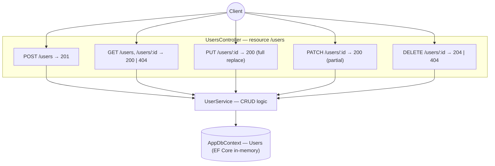

# sortIndex
<!-- @starci/seperator -->
3
<!-- @starci/seperator -->
# lang
<!-- @starci/seperator -->
csharp
<!-- @starci/seperator -->
# body
<!-- @starci/seperator -->
## 1. Lời mở đầu

*"Vì sao `PUT` gọi lại 2 lần vẫn an toàn còn `POST` thì không, và client làm sao biết một request thành công ra sao mà không cần đọc body?"* — một **Senior Engineer** đặt câu hỏi. **Mid-level Developer** đáp: *"Em cứ trả về 200 với một message `success: true` cho mọi thao tác là xong."* Câu trả lời thiếu chiều sâu: gộp tất cả vào 200 vứt bỏ tầng thông tin mà chính giao thức HTTP đã chuẩn hoá — client không phân biệt được "đã tạo mới" (201) với "đọc được" (200) hay "xoá xong rỗng body" (204), không biết "không có resource" (404) để dừng retry, và che mất việc một verb là idempotent hay không.

Bài học triển khai một REST API quản lý `users` bằng **ASP.NET Core Web API + EF Core** (chạy trên host, không Docker):

- **Phần 2.1**: **thực hành** chạy backend rồi gọi từng verb để **quan sát** chính status code và body trả về — chứ không phải một flag tự chế.
- **Phần 2.2**: **lý thuyết** hệ thống hoá bản chất REST resource semantics: ánh xạ verb → thao tác, status code nói gì với client, và vì sao idempotency là *tính chất vốn có* của verb chứ không phải tuỳ chọn — kèm các **edge case** điển hình.

## 2. Các khái niệm cốt lõi

Bài tuân theo **Thực hành dẫn dắt Lý thuyết**. Học viên clone source, chạy **ASP.NET Core Web API** bằng `dotnet run` và gọi từng endpoint để **quan sát** mỗi HTTP verb ánh xạ tới đúng một thao tác CRUD, mỗi kết quả phản ánh qua status code (201/200/204/404), và so sánh trực tiếp PUT (thay toàn bộ) với PATCH (sửa một phần). Sau đó phần lý thuyết hệ thống hoá resource semantics, contract status code và **idempotency**, kèm phân tích các edge case chuyên sâu.

### 2.1. Thực hành

#### 2.1.1. Chuẩn bị source code và môi trường

Mục đích: chạy demo để thấy mỗi verb HTTP trả về đúng status code đã giao kèo và body tương ứng — và để so sánh PUT với PATCH trên cùng một resource.

Source: [StarCi-Academy/fs-3-rest-api-design-and-documentation-0-restful-api-crud-best-practices](https://github.com/StarCi-Academy/fs-3-rest-api-design-and-documentation-0-restful-api-crud-best-practices) trên GitHub.

```bash
# Bước 1: Clone repository về máy local
git clone https://github.com/StarCi-Academy/fs-3-rest-api-design-and-documentation-0-restful-api-crud-best-practices.git

# Bước 2: Di chuyển vào đúng thư mục bài học
cd fs-3-rest-api-design-and-documentation-0-restful-api-crud-best-practices
```

#### 2.1.2. Kiến trúc / thành phần

Demo là một REST API mỏng quanh resource `users`, dùng EF Core với provider in-memory để chạy zero-config:

- `UsersController`: HTTP adapter — map mỗi verb (`GET`/`POST`/`PUT`/`PATCH`/`DELETE`) tới một action, đặt status code đúng qua kiểu trả `Results`.
- `UserService`: nghiệp vụ CRUD — tách khỏi controller, ném `KeyNotFoundException` khi id không tồn tại.
- `AppDbContext`: EF Core `DbContext` — bảng `Users` in-memory.
- `User`: model phẳng `{ id, name, email }` — contract JSON trả về client.

| Thành phần | File | Vai trò |
| --- | --- | --- |
| `UsersController` | `Controllers/UsersController.cs` | Map verb → action + status code (201/200/204/404) |
| `UserService` | `Services/UserService.cs` | Nghiệp vụ CRUD; phân biệt PUT vs PATCH |
| `AppDbContext` | `Data/AppDbContext.cs` | EF Core context, bảng `Users` |
| `User` | `Models/User.cs` | Model resource `{ id, name, email }` |



Hình 1: Mỗi HTTP verb ánh xạ tới một thao tác trên resource `users`; status code phản ánh kết quả; service tách nghiệp vụ khỏi controller.

#### 2.1.3. Giải thích code và bản chất

Trọng tâm: *vì sao mỗi verb ánh xạ tới một thao tác cụ thể, status code nào đi với thao tác nào, và vì sao PUT idempotent còn POST thì không*.

##### 2.1.3.1. POST tạo resource — 201 Created, không idempotent

```csharp
// Controllers/UsersController.cs
[HttpPost]
public IResult Create([FromBody] UserInput input)
{
    var created = _service.Create(input.Name, input.Email);
    return Results.Created($"/users/{created.Id}", created);
}
```

`POST /users` tạo một resource *mới* mỗi lần gọi: `Results.Created` đặt HTTP 201 kèm body resource vừa tạo. Đây là lý do POST không **idempotent** — gọi 2 lần sinh 2 user với 2 id khác nhau. Status 201 (chứ không phải 200) báo cho client biết "một resource mới đã được tạo", phân biệt rõ với việc chỉ đọc.

##### 2.1.3.2. GET đọc resource — 200 khi có, 404 khi thiếu

```csharp
// Controllers/UsersController.cs
[HttpGet]
public IResult FindAll() => Results.Ok(_service.FindAll());

[HttpGet("{id}")]
public IResult FindOne(string id)
{
    var user = _service.FindOne(id); // throws KeyNotFoundException if missing
    return Results.Ok(user);
}
```

`GET` chỉ đọc, không đổi state (safe). Có resource → HTTP 200 + body. Id không tồn tại → service ném `KeyNotFoundException`, một exception handler dịch thành HTTP 404. Việc trả 404 (thay vì 200 với body rỗng) cho client biết chính xác "resource này không có" để dừng retry hoặc hiển thị đúng.

##### 2.1.3.3. PUT thay toàn bộ vs PATCH sửa một phần — cùng 200 nhưng khác semantics

```csharp
// Services/UserService.cs
// PUT: replace EVERYTHING — fields not sent reset to default
public User Replace(string id, string name, string email)
{
    var row = _db.Users.Find(id) ?? throw new KeyNotFoundException(id);
    row.Name = name;   // replace whole field
    row.Email = email; // replace whole field
    _db.SaveChanges();
    return row;
}

// PATCH: change only the SENT fields — omitted fields stay
public User Patch(string id, string? name, string? email)
{
    var row = _db.Users.Find(id) ?? throw new KeyNotFoundException(id);
    if (name is not null) row.Name = name;
    if (email is not null) row.Email = email;
    _db.SaveChanges();
    return row;
}
```

Cả hai trả HTTP 200, nhưng semantics khác hẳn: PUT thay toàn bộ representation (gửi thiếu field → field đó về mặc định), nên PUT **idempotent** — gọi lại cùng payload cho cùng kết quả. PATCH sửa một phần (chỉ field gửi lên mới đổi). Đây là khác biệt cốt lõi nhiều người nhầm: PUT không phải "update", nó là "replace".

##### 2.1.3.4. DELETE xoá resource — 204 No Content

```csharp
// Controllers/UsersController.cs
[HttpDelete("{id}")]
public IResult Remove(string id)
{
    _service.Remove(id); // throws KeyNotFoundException if missing
    return Results.NoContent();
}
```

`DELETE /users/:id` xoá thành công → HTTP 204 No Content: không có body vì không còn gì để trả. Id không tồn tại → 404. Chọn 204 (thay vì 200 với message) là cách REST nói "thao tác thành công, không có nội dung trả về" — client không cần parse body.

> Khái niệm này portable: REST resource semantics + status code + idempotency là chuẩn HTTP (RFC 7231), không bám framework. Đối chiếu ngắn — NestJS dùng decorator `@Post/@Get/@Put/@Patch/@Delete` + `@HttpCode`, Spring dùng `@PostMapping/...` + `ResponseEntity`, Go dùng `http.MethodPost/...` trên router (chi/gin) + `w.WriteHeader`. Cùng một ánh xạ verb → thao tác → status code; chỉ khác cú pháp khai báo.

#### 2.1.4. Chuẩn bị & khởi chạy

##### 2.1.4.1. Điều kiện cần trước

- **.NET SDK 8** (LTS).
- Port **3000** sẵn sàng trên host (đặt qua `app.Run("http://localhost:3000")` hoặc `launchSettings.json`).
- **Windows:** dùng `Invoke-RestMethod` thay cho `curl`.

##### 2.1.4.2. Khởi động

```bash
# Bước 1: Vào thư mục
cd backend/2-csharp

# Bước 2: Cài dependency
dotnet restore

# Bước 3: Chạy
dotnet watch run
```

App lắng nghe tại `http://localhost:3000`.

#### 2.1.5. Kiểm thử

**4 luồng** dưới đây kiểm chứng 4 mục tiêu:

- **Luồng 1 — `POST /users`:** tạo user.
- **Luồng 2 — `GET /users/:id`:** đọc theo id và đọc id không tồn tại.
- **Luồng 3 — `PUT`/`PATCH /users/:id`:** so sánh PUT (full replace) với PATCH (partial).
- **Luồng 4 — `DELETE /users/:id`:** xoá user. Chạy lần lượt vì luồng sau dùng id sinh ra ở luồng trước.

::::accordion
:::panel{title="Luồng 1 — POST tạo resource → 201"}

- Bước 1: gọi `POST /users` với body name/email.

  ```bash
  # Windows (PowerShell)
  Invoke-RestMethod -Uri "http://localhost:3000/users" -Method Post -ContentType "application/json" -Body '{"name":"Milo","email":"milo@example.com"}'

  # macOS / Linux
  # → Dán cURL vào Postman: Import → Raw text
  curl -s -X POST http://localhost:3000/users -H "Content-Type: application/json" -d '{"name":"Milo","email":"milo@example.com"}'
  ```

  Response phải trả về (HTTP 201):

  ```json
  { "id": "u1", "name": "Milo", "email": "milo@example.com" }
  ```

*Kết luận: Nếu response khớp JSON trên kèm status 201, hệ thống xác nhận:*

- *POST ánh xạ tới thao tác tạo, server trả 201 Created kèm representation của resource mới (id do server gán).*

:::
:::panel{title="Luồng 2 — GET đọc: 200 khi có, 404 khi thiếu"}

- Bước 1: đọc user vừa tạo `GET /users/u1`.

  ```bash
  # Windows (PowerShell)
  Invoke-RestMethod -Uri "http://localhost:3000/users/u1"

  # macOS / Linux
  # → Dán cURL vào Postman: Import → Raw text
  curl -s http://localhost:3000/users/u1
  ```

  Response phải trả về (HTTP 200):

  ```json
  { "id": "u1", "name": "Milo", "email": "milo@example.com" }
  ```

- Bước 2: đọc id không tồn tại `GET /users/nope`.

  ```bash
  # Windows (PowerShell)
  Invoke-RestMethod -Uri "http://localhost:3000/users/nope"

  # macOS / Linux
  # → Dán cURL vào Postman: Import → Raw text
  curl -s -o /dev/null -w "%{http_code}" http://localhost:3000/users/nope
  ```

  Response phải trả về (HTTP 404):

  ```json
  { "message": "User with ID nope not found" }
  ```

*Kết luận: Nếu hai response trên khớp, hệ thống xác nhận:*

- *GET là safe (chỉ đọc); resource tồn tại → 200 + body, resource thiếu → 404 để client biết dừng, không nhầm với body rỗng.*

:::
:::panel{title="Luồng 3 — PUT (full replace) vs PATCH (partial)"}

- Bước 1: `PUT /users/u1` chỉ gửi `name` — quan sát `email` bị reset (full replace).

  ```bash
  # Windows (PowerShell)
  Invoke-RestMethod -Uri "http://localhost:3000/users/u1" -Method Put -ContentType "application/json" -Body '{"name":"Milo Renamed"}'

  # macOS / Linux
  # → Dán cURL vào Postman: Import → Raw text
  curl -s -X PUT http://localhost:3000/users/u1 -H "Content-Type: application/json" -d '{"name":"Milo Renamed"}'
  ```

  Response phải trả về (HTTP 200):

  ```json
  { "id": "u1", "name": "Milo Renamed", "email": "" }
  ```

- Bước 2: `PATCH /users/u1` chỉ gửi `email` — quan sát `name` giữ nguyên (partial).

  ```bash
  # Windows (PowerShell)
  Invoke-RestMethod -Uri "http://localhost:3000/users/u1" -Method Patch -ContentType "application/json" -Body '{"email":"milo2@example.com"}'

  # macOS / Linux
  # → Dán cURL vào Postman: Import → Raw text
  curl -s -X PATCH http://localhost:3000/users/u1 -H "Content-Type: application/json" -d '{"email":"milo2@example.com"}'
  ```

  Response phải trả về (HTTP 200):

  ```json
  { "id": "u1", "name": "Milo Renamed", "email": "milo2@example.com" }
  ```

*Kết luận: Nếu hai response trên khớp, hệ thống xác nhận:*

- *PUT thay TOÀN BỘ representation (gửi thiếu `email` → `email` về rỗng) nên idempotent; PATCH chỉ đổi field được gửi (`name` giữ nguyên) — cùng 200 nhưng khác semantics.*

:::
:::panel{title="Luồng 4 — DELETE → 204 No Content"}

- Bước 1: xoá user `DELETE /users/u1`.

  ```bash
  # Windows (PowerShell)
  Invoke-RestMethod -Uri "http://localhost:3000/users/u1" -Method Delete

  # macOS / Linux
  # → Dán cURL vào Postman: Import → Raw text
  curl -s -o /dev/null -w "%{http_code}" -X DELETE http://localhost:3000/users/u1
  ```

  Response phải trả về (HTTP 204, không body):

  ```json
  
  ```

*Kết luận: Nếu status là 204 và body rỗng, hệ thống xác nhận:*

- *DELETE thành công trả 204 No Content — không có nội dung để trả; client không cần parse body, chỉ cần đọc status code.*

:::
::::

#### 2.1.6. Dọn tài nguyên

Bài này không sử dụng Docker, không cần dọn tài nguyên. Nhấn `Ctrl+C` trong terminal để dừng ASP.NET Core; dữ liệu in-memory tự mất khi process kết thúc.

#### 2.1.7. Đọc thêm

- **Tạo Web API với ASP.NET Core:** controller, routing và `IResult`/status code. ([ASP.NET Core — Web API](https://learn.microsoft.com/aspnet/core/web-api))
- **EF Core in-memory provider:** dùng cho demo/test không cần database thật. ([EF Core — In-memory](https://learn.microsoft.com/ef/core/providers/in-memory))
- **HTTP semantics (RFC 9110):** định nghĩa method semantics, idempotency và status code. ([RFC 9110 — HTTP Semantics](https://www.rfc-editor.org/rfc/rfc9110))

### 2.2. Lý thuyết

#### 2.2.1. Bản chất

Bản chất của REST gói gọn trong một điều: **HTTP đã chuẩn hoá sẵn một bộ verb + status code mang ngữ nghĩa, và một API tốt là API *nói đúng* thứ ngôn ngữ đó thay vì tự chế flag riêng**. Resource (`users`) là danh từ; verb là động từ tác động lên danh từ đó; status code là câu trả lời ngắn gọn về kết quả. Ba mặt dưới đây không phải ba quy ước rời rạc mà là ba góc nhìn của cùng bản chất "dùng đúng giao thức".

- **Verb ánh xạ tới thao tác (resource semantics).** Mỗi verb có một ý nghĩa cố định: `POST` tạo, `GET` đọc, `PUT` thay toàn bộ, `PATCH` sửa một phần, `DELETE` xoá. Vì sao cốt lõi chứ không phải tuỳ thích: client, proxy, cache đều hiểu các verb này theo chuẩn — `GET` được phép cache vì là safe, `POST` thì không. Tự gộp mọi thứ vào `POST /doEverything` vứt bỏ toàn bộ tầng tối ưu và khả năng đoán hành vi đó. Kiểm chứng ở Luồng 3: cùng resource, PUT và PATCH cho kết quả khác nhau đúng theo semantics.
- **Status code nói gì với client (contract quan sát được).** Status code là phần *machine-readable* của câu trả lời: `201` "đã tạo mới" (khác `200` "đọc/cập nhật ok"), `204` "thành công, không có body", `404` "resource không tồn tại". Vì sao quan trọng: client quyết định luồng xử lý dựa trên status *trước khi* đọc body — 404 thì dừng retry, 201 thì lấy `Location` của resource mới. Trả 200 cho tất cả buộc client phải bóc body để đoán, dễ sai. Kiểm chứng ở Luồng 1/2/4: mỗi thao tác phản ánh qua đúng một status code.
- **Idempotency là tính chất vốn có của verb.** `GET`, `PUT`, `DELETE` là **idempotent** — gọi N lần cho cùng *trạng thái cuối* như gọi 1 lần; `POST` thì không (mỗi lần tạo một resource mới). Vì sao đây là bản chất chứ không phải chi tiết: idempotency quyết định client/proxy có được phép *retry an toàn* khi mạng chập chờn hay không. PUT thay toàn bộ nên gọi lại cùng payload là an toàn; POST gọi lại sinh bản ghi trùng — đây là lý do form submit hay cần idempotency key. Kiểm chứng ở Luồng 1 (POST tạo id mới) vs Luồng 3 (PUT lặp lại cho cùng kết quả).

| Verb | Thao tác | Status thành công | Safe | Idempotent |
| --- | --- | --- | --- | --- |
| `POST` | Tạo | 201 | Không | Không |
| `GET` | Đọc | 200 | Có | Có |
| `PUT` | Thay toàn bộ | 200 | Không | Có |
| `PATCH` | Sửa một phần | 200 | Không | Không (nói chung) |
| `DELETE` | Xoá | 204 | Không | Có |

Gộp lại: thiết kế REST tốt = chọn đúng verb cho thao tác + trả đúng status code cho kết quả + tôn trọng tính idempotent của verb. Học một framework REST mới chính là tìm xem nó cho bạn khai báo ba thứ này thế nào (ASP.NET Core: attribute `[HttpPost]`/... + `Results.Created/Ok/NoContent/NotFound`).

#### 2.2.2. Các trường hợp biên (edge cases) cần lưu ý

- **Dùng 200 cho mọi thứ:** client mất khả năng phân biệt tạo/đọc/xoá và phải parse body để đoán. **Giải pháp:** trả 201 khi tạo (kèm `Location`), 204 khi xoá, 404 khi không thấy — qua `Results.Created/NoContent/NotFound`.
- **Nhầm PUT là "update":** dùng PUT mà chỉ gửi một field khiến field còn lại bị reset ngoài ý muốn. **Giải pháp:** PUT = thay toàn bộ (gửi đủ field); cần sửa một phần thì dùng PATCH.
- **POST không idempotent gây bản ghi trùng:** client retry khi timeout sinh nhiều resource. **Giải pháp:** dùng idempotency key (header `Idempotency-Key`) hoặc unique constraint phía DB.
- **404 vs 400 vs 422:** id sai định dạng khác id không tồn tại khác body không hợp lệ. **Giải pháp:** 404 cho resource thiếu, 400 cho request malformed, 422 cho validation fail — đừng gộp hết vào 404.

## 3. Tổng kết

### 3.1. Các câu hỏi dễ bị phỏng vấn

- **Câu hỏi 1: Khác biệt giữa PUT và PATCH là gì, và vì sao PUT idempotent còn PATCH thì không?**
  - Ý interviewer muốn nghe: PUT thay toàn bộ representation, PATCH sửa một phần; idempotency suy ra từ semantics đó.
  - Trả lời mẫu (ngắn): PUT thay *toàn bộ* representation của resource — gửi thiếu field thì field đó về mặc định — nên gọi lại cùng payload cho cùng trạng thái cuối, tức idempotent. PATCH chỉ đổi các field được gửi, nên nói chung không idempotent (ví dụ một patch kiểu "tăng counter"). Trong ASP.NET Core mình tách hai action `[HttpPut]`/`[HttpPatch]`, PUT gán đủ field còn PATCH chỉ gán field khác null.
- **Câu hỏi 2: Vì sao nên trả 201/204/404 thay vì 200 cho mọi response?**
  - Ý interviewer muốn nghe: status code là phần machine-readable giúp client xử lý đúng trước khi đọc body.
  - Trả lời mẫu (ngắn): Status code là câu trả lời ngắn gọn mà client, proxy và cache đều hiểu theo chuẩn HTTP. 201 báo "đã tạo resource mới" kèm `Location`, 204 báo "thành công không body" để client khỏi parse, 404 báo "không có resource" để dừng retry. Gộp tất cả vào 200 buộc client bóc body để đoán, dễ sai và mất khả năng cache. Trong ASP.NET Core dùng `Results.Created/NoContent/NotFound` thay vì luôn `Ok`.
- **Câu hỏi 3: Idempotency là gì và vì sao nó quan trọng trong môi trường mạng không tin cậy?**
  - Ý interviewer muốn nghe: gọi nhiều lần cho cùng trạng thái cuối; cho phép retry an toàn.
  - Trả lời mẫu (ngắn): Một thao tác idempotent là gọi N lần cho cùng *trạng thái cuối* như gọi 1 lần — GET, PUT, DELETE thuộc loại này, POST thì không. Điều này quan trọng vì khi mạng chập chờn và client không biết request trước có tới server chưa, nó được phép retry an toàn với verb idempotent. POST tạo resource thì retry sinh bản ghi trùng, nên thường cần idempotency key để khử trùng phía server.
<!-- @starci/seperator -->
