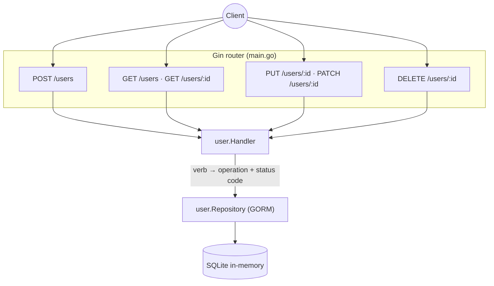

# sortIndex
<!-- @starci/seperator -->
4
<!-- @starci/seperator -->
# lang
<!-- @starci/seperator -->
go
<!-- @starci/seperator -->
# body
<!-- @starci/seperator -->
## 1. Opening

*"When a client calls `PUT /users/42` twice in a row with the same payload, does the second call create another record?"* — a **Senior Engineer** asks. A **Mid-level Developer** replies: *"I just use `POST` for every route to keep it simple, as long as the data lands in the DB."* The answer lacks depth: collapsing every operation into one verb means the client cannot read intent from the contract, returning the wrong status code stops the caller from distinguishing *creation* (201) from *update* (200) or *not found* (404), and it loses **idempotency** — a repeated `PUT` must yield the same result, while a repeated `POST` duplicates the resource.

This lesson ships **Go** with **Gin** (HTTP) and **GORM** (data access), running on the host with no Docker. REST is group ① — an observable concept: you do not need to read internal code, just look at the returned **status code + body** to verify the semantics:

- **Part 2.1**: **hands-on** runs a backend with a `users` CRUD resource and calls each verb to **observe** the verb → operation mapping and status codes.
- **Part 2.2**: **theory** consolidates the *resource-oriented* essence of REST plus the **edge cases** that arise from picking the wrong verb/status code.

## 2. Core concepts

This lesson follows **practice-led theory**. Students clone the source, run **Go** via `go run .`, and call the API to **observe**: `POST` returns `201`, `GET` returns `200` or `404`, `PUT` replaces the whole resource, `PATCH` updates only the sent fields, `DELETE` returns `204` with no body. The theory part then consolidates why each verb carries a fixed meaning, why `PUT` is idempotent but `POST` is not, and the edge cases.

### 2.1. Hands-on

#### 2.1.1. Prepare source code and environment

Purpose: run the demo to see each HTTP verb map to the correct CRUD operation and return the right status code — `POST → 201`, `GET → 200|404`, `PUT/PATCH → 200|404`, `DELETE → 204|404`.

Source: [StarCi-Academy/fs-3-rest-api-design-and-documentation-0-restful-api-crud-best-practices](https://github.com/StarCi-Academy/fs-3-rest-api-design-and-documentation-0-restful-api-crud-best-practices) on GitHub.

```bash
# Step 1: Clone the repository locally
git clone https://github.com/StarCi-Academy/fs-3-rest-api-design-and-documentation-0-restful-api-crud-best-practices.git

# Step 2: Navigate to the lesson directory
cd fs-3-rest-api-design-and-documentation-0-restful-api-crud-best-practices
```

#### 2.1.2. Architecture / components

The demo has one `users` resource with full CRUD, split into idiomatic Go layers:

- `main`: composition root — opens GORM (SQLite in-memory), runs `AutoMigrate`, wires the handler into the Gin router, and registers each route per verb.
- `user` package: the `User` model (GORM), a `Repository` wrapping `*gorm.DB`, and a `Handler` mapping each Gin handler ↔ one HTTP verb, setting the semantically correct status code.
- **GORM + SQLite in-memory:** zero-config storage, clone-and-run instantly, no external database required.

| Component | File | Role |
| --- | --- | --- |
| `main` | `main.go` | Composition root — opens DB, migrates, registers routes per verb |
| `User` + `Repository` | `user/user.go` | GORM model + data access (find/create/replace/patch/delete) |
| `Handler` | `user/handler.go` | Maps verb → operation, sets status code 201/200/204/404 |



Figure 1: The Gin router maps each verb to `Handler`; `Handler` picks the CRUD operation and the semantically correct status code, delegating storage to `Repository` over GORM.

#### 2.1.3. Code walkthrough and essence

Focus: *each HTTP verb maps to a fixed operation, and the returned status code is the contract the client observes*.

##### 2.1.3.1. POST creates a resource — returns 201 Created

```go
// user/handler.go
func (h *Handler) Create(c *gin.Context) {
    var body User
    if err := c.ShouldBindJSON(&body); err != nil {
        c.JSON(http.StatusBadRequest, gin.H{"message": "invalid body"})
        return
    }
    created := h.repo.Create(body.Name, body.Email)
    c.JSON(http.StatusCreated, created) // 201 — a new resource was created
}
```

`POST /users` *creates*, so it returns `http.StatusCreated` (201) plus the resource just created (including the server-generated `id`). This is the signal that tells the client a new resource was born — distinct from `200`. `POST` is not **idempotent**: calling it N times creates N different resources.

##### 2.1.3.2. GET reads a resource — 200 when present, 404 when missing

```go
// user/handler.go
func (h *Handler) FindOne(c *gin.Context) {
    u, ok := h.repo.FindByID(c.Param("id"))
    if !ok {
        c.JSON(http.StatusNotFound, gin.H{"message": "user not found"})
        return // 404 — the resource does not exist
    }
    c.JSON(http.StatusOK, u) // 200 — read succeeded
}
```

`GET` only *reads*, never changes state. When the resource exists it returns `200 OK` + body; when the id is missing it returns `404 Not Found`. Distinguishing `200`/`404` is how the client knows whether the resource exists without guessing from the body.

##### 2.1.3.3. PUT full replace vs PATCH partial update

```go
// user/handler.go
func (h *Handler) Replace(c *gin.Context) { // PUT — full replace
    var body User
    _ = c.ShouldBindJSON(&body)
    u, ok := h.repo.Replace(c.Param("id"), body.Name, body.Email)
    if !ok {
        c.JSON(http.StatusNotFound, gin.H{"message": "user not found"})
        return
    }
    c.JSON(http.StatusOK, u) // 200 — all fields overwritten
}

func (h *Handler) Patch(c *gin.Context) { // PATCH — partial update
    var body map[string]any
    _ = c.ShouldBindJSON(&body)
    u, ok := h.repo.Patch(c.Param("id"), body) // only present fields change
    if !ok {
        c.JSON(http.StatusNotFound, gin.H{"message": "user not found"})
        return
    }
    c.JSON(http.StatusOK, u) // 200
}
```

`PUT` means *replace the whole representation*: fields not sent get set to empty — `Replace` overwrites both `name` and `email`. `PATCH` means *partial update*: `Patch` reads a `map[string]any` and updates only keys that are present. Both return `200` when the resource exists and `404` when not. `PUT` is **idempotent** (resending the same payload yields the same state); `PATCH` is usually idempotent with an explicit payload but is not required to be by spec.

##### 2.1.3.4. DELETE removes a resource — returns 204 No Content

```go
// user/handler.go
func (h *Handler) Remove(c *gin.Context) {
    if ok := h.repo.Delete(c.Param("id")); !ok {
        c.JSON(http.StatusNotFound, gin.H{"message": "user not found"})
        return // 404 — nothing to delete
    }
    c.Status(http.StatusNoContent) // 204 — deleted, no body
}
```

A successful `DELETE` returns `204 No Content`: the operation completed and there is *no body* to return — use `c.Status`, not `c.JSON`. If the id does not exist it returns `404`. The status code is the contract: `204` says "processed, nothing to send back".

> This concept is portable: REST semantics (verb → operation, status code, idempotency) is a universal HTTP contract, framework-independent. Quick contrast — NestJS uses the decorators `@Post/@Get/@Put/@Patch/@Delete` + `@HttpCode(201)`; Spring uses `@PostMapping/@GetMapping/...` + `ResponseEntity.status(...)`; ASP.NET Core uses `[HttpPost]/[HttpGet]/...` + `Created()/Ok()/NoContent()/NotFound()`. Go/Gin sets the status code by hand via `c.JSON(code, ...)` / `c.Status(code)` — same idea: each verb maps to one operation, the status code is the standard signal for the client.

#### 2.1.4. Prerequisites and startup

##### 2.1.4.1. Prerequisites

- **Go 1.22+**.
- Port **3000** available on the host (Gin runs `r.Run(":3000")`).
- **Windows:** use `Invoke-RestMethod` instead of `curl`.

##### 2.1.4.2. Start

```bash
# Step 1: Enter directory
cd backend/3-go

# Step 2: Install dependencies
go mod download

# Step 3: Run
go run .
```

The app listens at `http://localhost:3000`. The in-memory database is pre-seeded with one demo user at startup (via an internal `POST /users/demo/seed-one`) so the read flows have data ready.

#### 2.1.5. Verification

The **4 flows** below verify the REST contract:

- **Flow 1 — `POST /users`:** create a user.
- **Flow 2 — `GET /users/:id` (200) and a missing id (404):** read by id.
- **Flow 3 — `PUT /users/:id` then `PATCH /users/:id`:** compare `PUT` (full replace) with `PATCH` (partial update).
- **Flow 4 — `DELETE /users/:id` (204 with no body):** delete a user.

::::accordion
:::panel{title="Flow 1 — POST creates a resource → 201"}

- Step 1: call `POST /users` with a name/email body.

  ```bash
  # Windows (PowerShell)
  Invoke-RestMethod -Uri "http://localhost:3000/users" -Method Post -ContentType "application/json" -Body '{"name":"Ada Lovelace","email":"ada@example.com"}'

  # macOS / Linux
  # → Paste cURL into Postman: Import → Raw text
  curl -s -X POST http://localhost:3000/users -H "Content-Type: application/json" -d '{"name":"Ada Lovelace","email":"ada@example.com"}'
  ```

  Response should return (HTTP 201):

  ```json
  { "id": "u-2", "name": "Ada Lovelace", "email": "ada@example.com" }
  ```

*Conclusion: If the response matches the JSON above and the status is 201, the system confirms:*

- *`POST` maps to the create operation, returning `201 Created` + the new resource with a server-generated `id` — distinct from the `200` of read/update.*

:::
:::panel{title="Flow 2 — GET reads a resource → 200 or 404"}

- Step 1: read the user just created — `GET /users/u-2`.

  ```bash
  # Windows (PowerShell)
  Invoke-RestMethod -Uri "http://localhost:3000/users/u-2"

  # macOS / Linux
  # → Paste cURL into Postman: Import → Raw text
  curl -s http://localhost:3000/users/u-2
  ```

  Response should return (HTTP 200):

  ```json
  { "id": "u-2", "name": "Ada Lovelace", "email": "ada@example.com" }
  ```

- Step 2: read a missing id — `GET /users/u-999`.

  ```bash
  # Windows (PowerShell)
  Invoke-RestMethod -Uri "http://localhost:3000/users/u-999"

  # macOS / Linux
  # → Paste cURL into Postman: Import → Raw text
  curl -s -w "\n%{http_code}" http://localhost:3000/users/u-999
  ```

  Response should return (HTTP 404):

  ```json
  { "message": "user not found" }
  ```

*Conclusion: If `u-2` returns 200 while `u-999` returns 404, the system confirms:*

- *`GET` only reads, using the status code to distinguish existence (`200`) from absence (`404`) — the client does not guess from the body.*

:::
:::panel{title="Flow 3 — PUT (full replace) vs PATCH (partial)"}

- Step 1: `PUT /users/u-2` sending only `name` (full replace → `email` is reset to empty).

  ```bash
  # Windows (PowerShell)
  Invoke-RestMethod -Uri "http://localhost:3000/users/u-2" -Method Put -ContentType "application/json" -Body '{"name":"Ada L."}'

  # macOS / Linux
  # → Paste cURL into Postman: Import → Raw text
  curl -s -X PUT http://localhost:3000/users/u-2 -H "Content-Type: application/json" -d '{"name":"Ada L."}'
  ```

  Response should return (HTTP 200):

  ```json
  { "id": "u-2", "name": "Ada L.", "email": "" }
  ```

- Step 2: `PATCH /users/u-2` sending only `email` (partial → `name` is kept).

  ```bash
  # Windows (PowerShell)
  Invoke-RestMethod -Uri "http://localhost:3000/users/u-2" -Method Patch -ContentType "application/json" -Body '{"email":"ada@new.com"}'

  # macOS / Linux
  # → Paste cURL into Postman: Import → Raw text
  curl -s -X PATCH http://localhost:3000/users/u-2 -H "Content-Type: application/json" -d '{"email":"ada@new.com"}'
  ```

  Response should return (HTTP 200):

  ```json
  { "id": "u-2", "name": "Ada L.", "email": "ada@new.com" }
  ```

*Conclusion: If PUT makes `email` empty while PATCH keeps `name` and only changes `email`, the system confirms:*

- *`PUT` replaces the WHOLE representation (missing fields are reset), `PATCH` updates only the sent fields — both return `200` but with different update semantics.*

:::
:::panel{title="Flow 4 — DELETE removes a resource → 204 with no body"}

- Step 1: delete the user — `DELETE /users/u-2`.

  ```bash
  # Windows (PowerShell)
  Invoke-RestMethod -Uri "http://localhost:3000/users/u-2" -Method Delete

  # macOS / Linux
  # → Paste cURL into Postman: Import → Raw text
  curl -s -o /dev/null -w "%{http_code}" -X DELETE http://localhost:3000/users/u-2
  ```

  Response should return (HTTP 204) — no body:

  ```json

  ```

- Step 2: read again — `GET /users/u-2` now returns `404`.

*Conclusion: If DELETE returns 204 with no body and the subsequent GET returns 404, the system confirms:*

- *A successful `DELETE` returns `204 No Content` (no body — use `c.Status`, not `c.JSON`); the resource is gone from the system.*

:::
::::

#### 2.1.6. Cleanup

This lesson does not use Docker, no resource cleanup is needed. The database is SQLite in-memory, so it disappears when the process stops. Press `Ctrl+C` in the terminal to stop Go.

#### 2.1.7. Further reading

- **Gin web framework:** routing, JSON binding, setting status codes. ([Gin — Documentation](https://gin-gonic.com/docs/))
- **GORM:** models, AutoMigrate, CRUD via `*gorm.DB`. ([GORM — Documentation](https://gorm.io/docs/))
- **HTTP semantics (RFC 9110):** the standard meaning of methods and status codes. ([RFC 9110 — HTTP Semantics](https://datatracker.ietf.org/doc/html/rfc9110))

### 2.2. Theory

#### 2.2.1. The essence

The essence of REST is **resource-oriented**: the server exposes *resources* (here `users` and `users/:id`), the client operates on them through a set of standard HTTP verbs, and the **status code + body** is the observable contract — no need to know what language the server is written in. That is why REST is an agnostic concept: same contract, Go/Gin sets the status code by hand, another framework sets it via helpers, but the client sees the exact same thing.

- **Verbs carry fixed semantics.** Each verb maps to one kind of operation: `POST` creates, `GET` reads (no state change — *safe*), `PUT` replaces the whole representation, `PATCH` updates a part, `DELETE` removes. Why it matters: clients and proxies/caches rely on this semantics (e.g. `GET` is cacheable, `POST` is not). Collapsing everything into `POST` breaks the ability to reason from the contract. Verified in Flow 3: `PUT` resets the missing field, `PATCH` keeps it.
- **The status code is the standard signal for clients.** `201` (created) ≠ `200` (read/update succeeded) ≠ `204` (succeeded, no body) ≠ `404` (resource not found). The client distinguishes outcomes by status code rather than parsing the body to guess. In Gin this is the first argument of `c.JSON(code, ...)` or `c.Status(code)` — getting it wrong is a wrong contract even when the body is right.

| Verb | Operation | Success status | Idempotent |
| --- | --- | --- | --- |
| POST | Create | 201 | No |
| GET | Read | 200 (or 404) | Yes (safe) |
| PUT | Full replace | 200 (or 404) | Yes |
| PATCH | Partial update | 200 (or 404) | Usually |
| DELETE | Delete | 204 (or 404) | Yes |

- **Idempotency — why PUT differs from POST.** Idempotent means calling N times yields the same result as calling once. `PUT /users/42` with the same payload always leaves the resource in the same state, so clients/proxies can safely retry over a flaky network. `POST /users` does *not*: each call creates a new resource, so a blind retry produces duplicates. This is why a create operation usually needs an idempotency key if you want safe retries. Verified indirectly in Flow 1 (POST mints a new id each time) vs Flow 3 (PUT with the same payload → same state).

Putting it together: REST is not "assigning URLs to functions" but *mapping verbs → operations on resources + using the status code as the contract*. Understand this and you can read any REST API and predict its behavior without looking at the server code.

#### 2.2.2. Edge cases to internalize

- **Using the wrong verb (e.g. `POST` to update):** the client loses cache/retry ability and the contract is hard to read. **Solution:** map correctly — create with `POST`, full replace with `PUT`, partial update with `PATCH`.
- **PUT that sends only one field:** by spec the missing field is treated as set-to-empty → unintended data loss. **Solution:** use `PATCH` for partial changes; `PUT` always sends the full representation.
- **DELETE/GET on a missing id returning 200:** hides the error, the client thinks it succeeded. **Solution:** return a clear `404` when the resource does not exist.
- **Returning a body for 204:** violates `No Content` — some clients/proxies ignore it or error out. **Solution:** use `c.Status(http.StatusNoContent)` (not `c.JSON`).
- `map[string]any` for PATCH cannot tell "sent null" from "not sent": easy to patch wrongly. **Solution:** check whether the key is present in the map (`_, ok := body["email"]`) before updating.

## 3. Wrap-up

### 3.1. Common interview questions

- **Question 1: What is the difference between PUT and PATCH, and when do you use each?**
  - What interviewers want to hear: PUT replaces the whole representation, PATCH updates a part; it relates to how missing fields are handled.
  - Sample answer (concise): `PUT` means *full replacement* of the resource — fields not sent are treated as set-to-empty/default, so the client must send the full representation. `PATCH` means *partial update* — only present fields change, the rest stay. In the Go demo, `PUT /users/u-2` sending only `name` makes `email` empty, while `PATCH` sending only `email` keeps `name`. Use `PUT` to replace the whole resource, `PATCH` to update a few fields.
- **Question 2: What is idempotency, and why is POST not idempotent while PUT is?**
  - What interviewers want to hear: idempotent = N calls behave like one; it affects safe retries.
  - Sample answer (concise): Idempotent means repeating a request yields the same result/state. `PUT /users/42` with the same payload always brings the resource to the same state, so it is safe to retry on a network error. `POST /users` creates a new resource on every call, so a blind retry produces duplicates — not idempotent. That is why a create operation usually needs an idempotency key for safe retries, while `PUT`/`DELETE`/`GET` retry naturally.
- **Question 3: Why does choosing the correct status code matter, e.g. 201 vs 200 vs 204?**
  - What interviewers want to hear: the status code is the contract clients/proxies rely on to handle the outcome.
  - Sample answer (concise): The status code is the standard signal that lets clients distinguish outcomes without parsing the body to guess: `201` says "a new resource was created" (with `Location`/body), `200` says "read/update ok", `204` says "succeeded but no body" (e.g. DELETE), `404` says "resource not found". Returning the wrong one — like `200` for everything — makes the caller and proxies/caches misbehave. In Gin it is the first argument of `c.JSON(code, ...)` or `c.Status(code)`.
<!-- @starci/seperator -->
