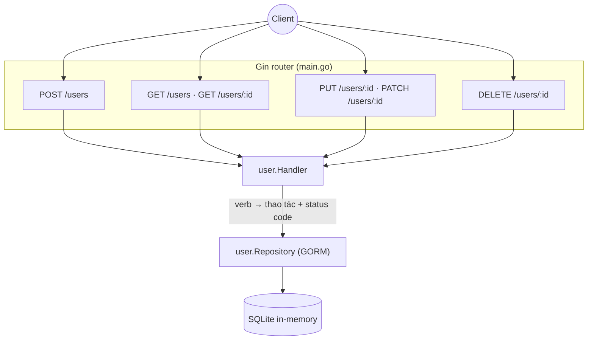

# sortIndex
<!-- @starci/seperator -->
4
<!-- @starci/seperator -->
# lang
<!-- @starci/seperator -->
go
<!-- @starci/seperator -->
# body
<!-- @starci/seperator -->
## 1. Lời mở đầu

*"Khi client gọi `PUT /users/42` hai lần liên tiếp với cùng payload, lần thứ hai có tạo thêm bản ghi không?"* — một **Senior Engineer** đặt câu hỏi. **Mid-level Developer** đáp: *"Em làm route nào cũng `POST` cho nhanh, miễn dữ liệu vào DB là được."* Câu trả lời thiếu chiều sâu: gộp mọi thao tác vào một verb làm client không đọc được ý định từ contract, status code trả về sai khiến phía gọi không phân biệt được *tạo mới* (201) với *cập nhật* (200) hay *không tìm thấy* (404), và đánh mất **idempotency** — `PUT` lặp lại phải cho cùng kết quả, còn `POST` lặp lại thì nhân đôi resource.

Bài học triển khai **Go** với **Gin** (HTTP) và **GORM** (truy cập dữ liệu), chạy trên host không cần Docker. REST là nhóm ① — concept quan sát được: bạn không cần đọc code nội bộ, chỉ cần nhìn **status code + body** trả về là kiểm chứng được semantics:

- **Phần 2.1**: **thực hành** chạy một backend CRUD resource `users` và gọi từng verb để **quan sát** ánh xạ verb → thao tác và status code.
- **Phần 2.2**: **lý thuyết** hệ thống hoá bản chất *resource-oriented* của REST và các **edge case** thường gặp khi đặt verb/status code sai.

## 2. Các khái niệm cốt lõi

Bài tuân theo **Thực hành dẫn dắt Lý thuyết**. Học viên clone source, chạy **Go** bằng `go run .` và gọi API để **quan sát**: `POST` trả `201`, `GET` trả `200` hoặc `404`, `PUT` thay toàn bộ resource, `PATCH` chỉ sửa field được gửi, `DELETE` trả `204` không body. Sau đó phần lý thuyết hệ thống hoá vì sao mỗi verb mang một ngữ nghĩa cố định, vì sao `PUT` idempotent mà `POST` thì không, và các edge case.

### 2.1. Thực hành

#### 2.1.1. Chuẩn bị source code và môi trường

Mục đích: chạy demo để thấy từng HTTP verb ánh xạ tới đúng thao tác CRUD và trả về đúng status code — `POST → 201`, `GET → 200|404`, `PUT/PATCH → 200|404`, `DELETE → 204|404`.

Source: [StarCi-Academy/fs-3-rest-api-design-and-documentation-0-restful-api-crud-best-practices](https://github.com/StarCi-Academy/fs-3-rest-api-design-and-documentation-0-restful-api-crud-best-practices) trên GitHub.

```bash
# Bước 1: Clone repository về máy local
git clone https://github.com/StarCi-Academy/fs-3-rest-api-design-and-documentation-0-restful-api-crud-best-practices.git

# Bước 2: Di chuyển vào đúng thư mục bài học
cd fs-3-rest-api-design-and-documentation-0-restful-api-crud-best-practices
```

#### 2.1.2. Kiến trúc / thành phần

Demo có một resource `users` với đầy đủ CRUD, chia theo lớp idiomatic Go:

- `main`: composition root — mở GORM (SQLite in-memory), `AutoMigrate`, ghép handler vào router Gin và đăng ký từng route theo verb.
- `user` package: `User` model (GORM), `Repository` bọc `*gorm.DB`, và `Handler` ánh xạ mỗi Gin handler ↔ một HTTP verb, set status code đúng semantics.
- **GORM + SQLite in-memory:** lưu trữ zero-config, clone là chạy ngay, không cần cài database ngoài.

| Thành phần | File | Vai trò |
| --- | --- | --- |
| `main` | `main.go` | Composition root — mở DB, migrate, đăng ký route theo verb |
| `User` + `Repository` | `user/user.go` | Model GORM + truy cập dữ liệu (find/create/replace/patch/delete) |
| `Handler` | `user/handler.go` | Ánh xạ verb → thao tác, set status code 201/200/204/404 |



Hình 1: Router Gin ánh xạ mỗi verb tới `Handler`; `Handler` chọn thao tác CRUD và status code đúng semantics, ủy quyền lưu trữ cho `Repository` trên GORM.

#### 2.1.3. Giải thích code và bản chất

Trọng tâm: *mỗi HTTP verb ánh xạ tới một thao tác cố định, và status code trả về là contract mà client quan sát được*.

##### 2.1.3.1. POST tạo resource — trả 201 Created

```go
// user/handler.go
func (h *Handler) Create(c *gin.Context) {
    var body User
    if err := c.ShouldBindJSON(&body); err != nil {
        c.JSON(http.StatusBadRequest, gin.H{"message": "invalid body"})
        return
    }
    created := h.repo.Create(body.Name, body.Email)
    c.JSON(http.StatusCreated, created) // 201 — a new resource was created
}
```

`POST /users` *tạo mới* nên trả `http.StatusCreated` (201) kèm resource vừa tạo (gồm `id` server sinh ra). Đây là tín hiệu để client biết một resource mới đã ra đời — khác hẳn `200`. `POST` không **idempotent**: gọi N lần tạo N resource khác nhau.

##### 2.1.3.2. GET đọc resource — 200 khi có, 404 khi thiếu

```go
// user/handler.go
func (h *Handler) FindOne(c *gin.Context) {
    u, ok := h.repo.FindByID(c.Param("id"))
    if !ok {
        c.JSON(http.StatusNotFound, gin.H{"message": "user not found"})
        return // 404 — the resource does not exist
    }
    c.JSON(http.StatusOK, u) // 200 — read succeeded
}
```

`GET` chỉ *đọc*, không đổi state. Khi resource tồn tại trả `200 OK` + body; khi id không có trả `404 Not Found`. Phân biệt `200`/`404` là cách client biết tài nguyên có tồn tại hay không mà không cần đoán từ body.

##### 2.1.3.3. PUT thay toàn bộ vs PATCH sửa một phần

```go
// user/handler.go
func (h *Handler) Replace(c *gin.Context) { // PUT — full replace
    var body User
    _ = c.ShouldBindJSON(&body)
    u, ok := h.repo.Replace(c.Param("id"), body.Name, body.Email)
    if !ok {
        c.JSON(http.StatusNotFound, gin.H{"message": "user not found"})
        return
    }
    c.JSON(http.StatusOK, u) // 200 — all fields overwritten
}

func (h *Handler) Patch(c *gin.Context) { // PATCH — partial update
    var body map[string]any
    _ = c.ShouldBindJSON(&body)
    u, ok := h.repo.Patch(c.Param("id"), body) // only present fields change
    if !ok {
        c.JSON(http.StatusNotFound, gin.H{"message": "user not found"})
        return
    }
    c.JSON(http.StatusOK, u) // 200
}
```

`PUT` mang nghĩa *thay toàn bộ representation*: field không gửi sẽ bị set về rỗng — `Replace` ghi đè cả `name` lẫn `email`. `PATCH` mang nghĩa *sửa một phần*: `Patch` đọc `map[string]any`, chỉ key nào có mặt mới cập nhật. Cả hai trả `200` khi có resource, `404` khi không. `PUT` **idempotent** (gửi lại cùng payload cho cùng state); `PATCH` thường cũng idempotent với payload tường minh nhưng không bắt buộc theo spec.

##### 2.1.3.4. DELETE xóa resource — trả 204 No Content

```go
// user/handler.go
func (h *Handler) Remove(c *gin.Context) {
    if ok := h.repo.Delete(c.Param("id")); !ok {
        c.JSON(http.StatusNotFound, gin.H{"message": "user not found"})
        return // 404 — nothing to delete
    }
    c.Status(http.StatusNoContent) // 204 — deleted, no body
}
```

`DELETE` thành công trả `204 No Content`: thao tác hoàn tất và *không có body* để trả — dùng `c.Status` chứ không `c.JSON`. Nếu id không tồn tại trả `404`. Status code chính là contract: `204` nói "đã xử lý, không có gì gửi lại".

> Khái niệm này portable: REST semantics (verb → thao tác, status code, idempotency) là contract HTTP phổ quát, không phụ thuộc framework. Đối chiếu ngắn — NestJS dùng decorator `@Post/@Get/@Put/@Patch/@Delete` + `@HttpCode(201)`; Spring dùng `@PostMapping/@GetMapping/...` + `ResponseEntity.status(...)`; ASP.NET Core dùng `[HttpPost]/[HttpGet]/...` + `Created()/Ok()/NoContent()/NotFound()`. Go/Gin set status code thủ công qua `c.JSON(code, ...)` / `c.Status(code)` — cùng một ý: mỗi verb ánh xạ một thao tác, status code là tín hiệu chuẩn cho client.

#### 2.1.4. Chuẩn bị & khởi chạy

##### 2.1.4.1. Điều kiện cần trước

- **Go 1.22+**.
- Port **3000** sẵn sàng trên host (Gin chạy `r.Run(":3000")`).
- **Windows:** dùng `Invoke-RestMethod` thay cho `curl`.

##### 2.1.4.2. Khởi động

```bash
# Bước 1: Vào thư mục
cd backend/3-go

# Bước 2: Cài dependency
go mod download

# Bước 3: Chạy
go run .
```

App lắng nghe tại `http://localhost:3000`. Database in-memory được seed sẵn một user demo lúc khởi động (qua `POST /users/demo/seed-one` nội bộ) để các flow đọc có sẵn dữ liệu.

#### 2.1.5. Kiểm thử

**4 luồng** dưới đây kiểm chứng contract REST:

- **Luồng 1 — `POST /users`:** tạo user.
- **Luồng 2 — `GET /users/:id` (200) và id không tồn tại (404):** đọc theo id.
- **Luồng 3 — `PUT /users/:id` rồi `PATCH /users/:id`:** so sánh `PUT` (thay toàn bộ) với `PATCH` (sửa một phần).
- **Luồng 4 — `DELETE /users/:id` (204 không body):** xóa user.

::::accordion
:::panel{title="Luồng 1 — POST tạo resource → 201"}

- Bước 1: gọi `POST /users` với body name/email.

  ```bash
  # Windows (PowerShell)
  Invoke-RestMethod -Uri "http://localhost:3000/users" -Method Post -ContentType "application/json" -Body '{"name":"Ada Lovelace","email":"ada@example.com"}'

  # macOS / Linux
  # → Dán cURL vào Postman: Import → Raw text
  curl -s -X POST http://localhost:3000/users -H "Content-Type: application/json" -d '{"name":"Ada Lovelace","email":"ada@example.com"}'
  ```

  Response phải trả về (HTTP 201):

  ```json
  { "id": "u-2", "name": "Ada Lovelace", "email": "ada@example.com" }
  ```

*Kết luận: Nếu response khớp JSON trên và status là 201, hệ thống xác nhận:*

- *`POST` ánh xạ tới thao tác tạo, trả `201 Created` + resource mới có `id` server sinh — khác hẳn `200` của đọc/cập nhật.*

:::
:::panel{title="Luồng 2 — GET đọc resource → 200 hoặc 404"}

- Bước 1: đọc user vừa tạo — `GET /users/u-2`.

  ```bash
  # Windows (PowerShell)
  Invoke-RestMethod -Uri "http://localhost:3000/users/u-2"

  # macOS / Linux
  # → Dán cURL vào Postman: Import → Raw text
  curl -s http://localhost:3000/users/u-2
  ```

  Response phải trả về (HTTP 200):

  ```json
  { "id": "u-2", "name": "Ada Lovelace", "email": "ada@example.com" }
  ```

- Bước 2: đọc id không tồn tại — `GET /users/u-999`.

  ```bash
  # Windows (PowerShell)
  Invoke-RestMethod -Uri "http://localhost:3000/users/u-999"

  # macOS / Linux
  # → Dán cURL vào Postman: Import → Raw text
  curl -s -w "\n%{http_code}" http://localhost:3000/users/u-999
  ```

  Response phải trả về (HTTP 404):

  ```json
  { "message": "user not found" }
  ```

*Kết luận: Nếu `u-2` trả 200 còn `u-999` trả 404, hệ thống xác nhận:*

- *`GET` chỉ đọc, dùng status code để phân biệt tồn tại (`200`) với không tồn tại (`404`) — client không phải đoán từ body.*

:::
:::panel{title="Luồng 3 — PUT (full replace) vs PATCH (partial)"}

- Bước 1: `PUT /users/u-2` chỉ gửi `name` (full replace → `email` bị ghi về rỗng).

  ```bash
  # Windows (PowerShell)
  Invoke-RestMethod -Uri "http://localhost:3000/users/u-2" -Method Put -ContentType "application/json" -Body '{"name":"Ada L."}'

  # macOS / Linux
  # → Dán cURL vào Postman: Import → Raw text
  curl -s -X PUT http://localhost:3000/users/u-2 -H "Content-Type: application/json" -d '{"name":"Ada L."}'
  ```

  Response phải trả về (HTTP 200):

  ```json
  { "id": "u-2", "name": "Ada L.", "email": "" }
  ```

- Bước 2: `PATCH /users/u-2` chỉ gửi `email` (partial → `name` giữ nguyên).

  ```bash
  # Windows (PowerShell)
  Invoke-RestMethod -Uri "http://localhost:3000/users/u-2" -Method Patch -ContentType "application/json" -Body '{"email":"ada@new.com"}'

  # macOS / Linux
  # → Dán cURL vào Postman: Import → Raw text
  curl -s -X PATCH http://localhost:3000/users/u-2 -H "Content-Type: application/json" -d '{"email":"ada@new.com"}'
  ```

  Response phải trả về (HTTP 200):

  ```json
  { "id": "u-2", "name": "Ada L.", "email": "ada@new.com" }
  ```

*Kết luận: Nếu PUT làm `email` rỗng còn PATCH giữ `name` và chỉ đổi `email`, hệ thống xác nhận:*

- *`PUT` thay TOÀN BỘ representation (field thiếu bị reset), `PATCH` chỉ sửa field được gửi — cùng trả `200` nhưng ngữ nghĩa cập nhật khác nhau.*

:::
:::panel{title="Luồng 4 — DELETE xóa resource → 204 không body"}

- Bước 1: xóa user — `DELETE /users/u-2`.

  ```bash
  # Windows (PowerShell)
  Invoke-RestMethod -Uri "http://localhost:3000/users/u-2" -Method Delete

  # macOS / Linux
  # → Dán cURL vào Postman: Import → Raw text
  curl -s -o /dev/null -w "%{http_code}" -X DELETE http://localhost:3000/users/u-2
  ```

  Response phải trả về (HTTP 204) — không có body:

  ```json

  ```

- Bước 2: đọc lại — `GET /users/u-2` giờ trả `404`.

*Kết luận: Nếu DELETE trả 204 không body và GET sau đó trả 404, hệ thống xác nhận:*

- *`DELETE` thành công trả `204 No Content` (không body — dùng `c.Status` chứ không `c.JSON`); resource đã biến mất khỏi hệ thống.*

:::
::::

#### 2.1.6. Dọn tài nguyên

Bài này không sử dụng Docker, không cần dọn tài nguyên. Database là SQLite in-memory nên tự biến mất khi tắt process. Nhấn `Ctrl+C` trong terminal để dừng Go.

#### 2.1.7. Đọc thêm

- **Gin web framework:** routing, binding JSON, set status code. ([Gin — Documentation](https://gin-gonic.com/docs/))
- **GORM:** model, AutoMigrate, CRUD qua `*gorm.DB`. ([GORM — Documentation](https://gorm.io/docs/))
- **HTTP semantics (RFC 9110):** ngữ nghĩa chuẩn của method và status code. ([RFC 9110 — HTTP Semantics](https://datatracker.ietf.org/doc/html/rfc9110))

### 2.2. Lý thuyết

#### 2.2.1. Bản chất

Bản chất của REST là **resource-oriented**: server phơi ra các *resource* (ở đây là `users` và `users/:id`), client thao tác lên chúng bằng tập HTTP verb chuẩn, và **status code + body** chính là contract quan sát được — không cần biết server viết bằng ngôn ngữ gì. Vì thế REST là concept agnostic: cùng một contract, Go/Gin set status code thủ công, framework khác set qua helper, nhưng client thấy y hệt nhau.

- **Verb mang ngữ nghĩa cố định.** Mỗi verb ánh xạ một loại thao tác: `POST` tạo, `GET` đọc (không đổi state — *safe*), `PUT` thay toàn bộ representation, `PATCH` sửa một phần, `DELETE` xóa. Vì sao quan trọng: client và proxy/cache dựa vào ngữ nghĩa này (vd `GET` được cache, `POST` thì không). Dồn mọi thứ vào `POST` phá vỡ khả năng suy luận từ contract. Kiểm chứng ở Luồng 3: `PUT` reset field thiếu, `PATCH` giữ nguyên.
- **Status code là tín hiệu chuẩn cho client.** `201` (tạo mới) ≠ `200` (đọc/cập nhật thành công) ≠ `204` (thành công, không body) ≠ `404` (resource không tồn tại). Client phân biệt kết quả qua status code chứ không parse body đoán mò. Trong Gin, đây là tham số đầu của `c.JSON(code, ...)` hoặc `c.Status(code)` — sai số này là sai contract dù body đúng.

| Verb | Thao tác | Status thành công | Idempotent |
| --- | --- | --- | --- |
| POST | Tạo mới | 201 | Không |
| GET | Đọc | 200 (hoặc 404) | Có (safe) |
| PUT | Thay toàn bộ | 200 (hoặc 404) | Có |
| PATCH | Sửa một phần | 200 (hoặc 404) | Thường có |
| DELETE | Xóa | 204 (hoặc 404) | Có |

- **Idempotency — vì sao PUT khác POST.** Idempotent nghĩa là gọi N lần cho cùng kết quả như gọi 1 lần. `PUT /users/42` với cùng payload luôn để resource ở cùng state, nên client/proxy có thể retry an toàn khi mạng chập chờn. `POST /users` thì *không*: mỗi lần tạo một resource mới, retry mù sẽ sinh bản trùng. Đây là lý do thao tác tạo mới thường cần idempotency key nếu muốn retry an toàn. Kiểm chứng gián tiếp ở Luồng 1 (POST sinh id mới mỗi lần) vs Luồng 3 (PUT cùng payload → cùng state).

Gộp lại: REST không phải "đặt URL cho hàm" mà là *ánh xạ verb → thao tác trên resource + dùng status code làm contract*. Hiểu được điều này thì đọc bất kỳ REST API nào cũng đoán đúng hành vi mà không cần xem code server.

#### 2.2.2. Các trường hợp biên (edge cases) cần lưu ý

- **Dùng sai verb (vd `POST` để cập nhật):** client mất khả năng cache/retry, contract khó đọc. **Giải pháp:** ánh xạ đúng — tạo dùng `POST`, thay toàn bộ dùng `PUT`, sửa một phần dùng `PATCH`.
- **PUT mà chỉ gửi một field:** theo spec field thiếu bị coi là set rỗng → mất dữ liệu ngoài ý muốn. **Giải pháp:** muốn sửa một phần thì dùng `PATCH`; `PUT` luôn gửi full representation.
- **DELETE/GET id không tồn tại nhưng trả 200:** che giấu lỗi, client tưởng thành công. **Giải pháp:** trả `404` rõ ràng khi resource không tồn tại.
- **Trả body cho 204:** vi phạm `No Content` — một số client/proxy bỏ qua hoặc lỗi. **Giải pháp:** dùng `c.Status(http.StatusNoContent)` (không `c.JSON`).
- `map[string]any` cho PATCH không phân biệt được "gửi null" và "không gửi": dễ patch nhầm. **Giải pháp:** kiểm tra key có mặt trong map (`_, ok := body["email"]`) trước khi cập nhật.

## 3. Tổng kết

### 3.1. Các câu hỏi dễ bị phỏng vấn

- **Câu hỏi 1: Khác nhau giữa PUT và PATCH là gì, khi nào dùng cái nào?**
  - Ý interviewer muốn nghe: PUT thay toàn bộ representation, PATCH sửa một phần; liên quan tới việc field thiếu bị xử lý ra sao.
  - Trả lời mẫu (ngắn): `PUT` mang nghĩa *thay toàn bộ* resource — field không gửi bị coi là set rỗng/mặc định, nên client phải gửi full representation. `PATCH` *sửa một phần* — chỉ field có mặt mới đổi, phần còn lại giữ nguyên. Trong demo Go, `PUT /users/u-2` chỉ gửi `name` làm `email` rỗng, còn `PATCH` chỉ gửi `email` giữ nguyên `name`. Dùng `PUT` khi thay cả resource, `PATCH` khi cập nhật vài field.
- **Câu hỏi 2: Idempotency là gì và vì sao POST không idempotent còn PUT thì có?**
  - Ý interviewer muốn nghe: idempotent = gọi N lần như gọi 1 lần; ảnh hưởng tới retry an toàn.
  - Trả lời mẫu (ngắn): Idempotent nghĩa là lặp lại request cho cùng kết quả/state. `PUT /users/42` với cùng payload luôn đưa resource về cùng state nên retry an toàn khi mạng lỗi. `POST /users` tạo một resource mới mỗi lần gọi, nên retry mù sẽ sinh bản trùng — không idempotent. Vì vậy thao tác tạo thường cần idempotency key nếu muốn retry an toàn, còn `PUT`/`DELETE`/`GET` thì retry tự nhiên.
- **Câu hỏi 3: Vì sao chọn status code đúng lại quan trọng, ví dụ 201 vs 200 vs 204?**
  - Ý interviewer muốn nghe: status code là contract client/proxy dựa vào để xử lý kết quả.
  - Trả lời mẫu (ngắn): Status code là tín hiệu chuẩn để client phân biệt kết quả mà không phải parse body đoán mò: `201` nói "đã tạo resource mới" (kèm `Location`/body), `200` nói "đọc/cập nhật ok", `204` nói "thành công nhưng không có body" (vd DELETE), `404` nói "resource không tồn tại". Trả sai — như `200` cho mọi thứ — khiến phía gọi và proxy/cache xử lý nhầm. Trong Gin đó là tham số đầu của `c.JSON(code, ...)` hoặc `c.Status(code)`.
<!-- @starci/seperator -->
